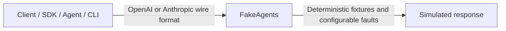
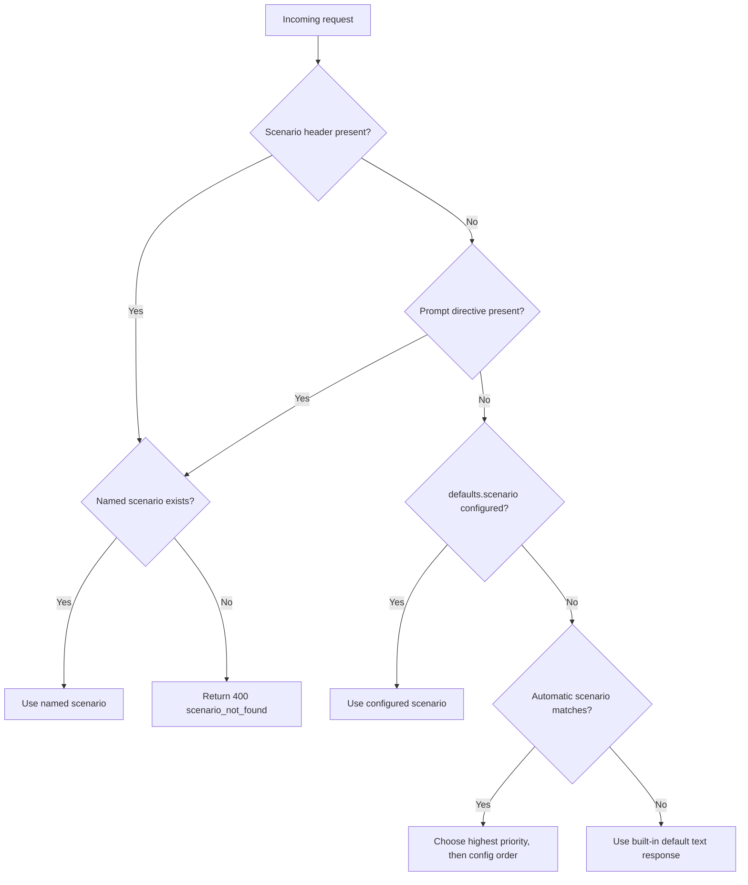
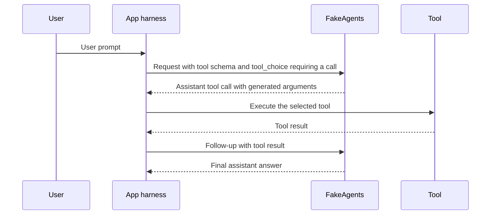
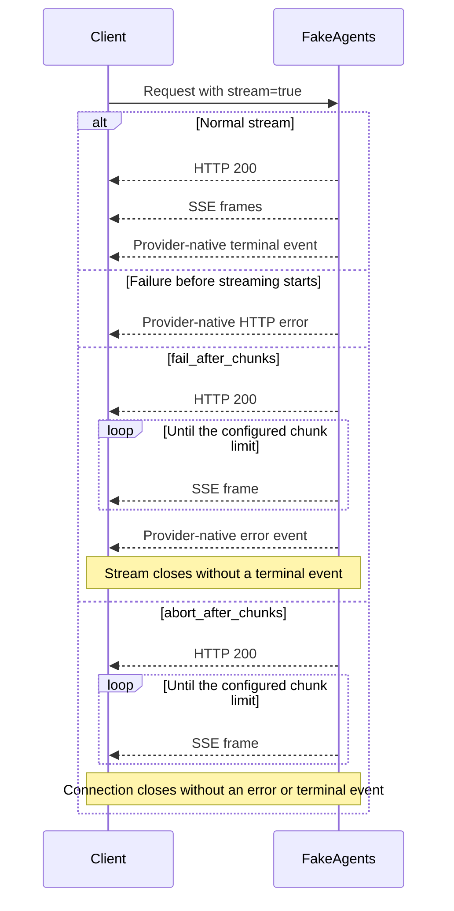
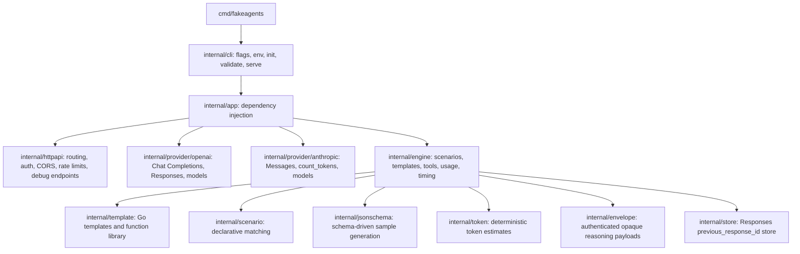

# FakeAgents

**A deterministic, local OpenAI + Anthropic API simulator for building AI apps without spending tokens.**

FakeAgents behaves like a real LLM provider at the HTTP boundary: Chat Completions, Responses, Messages, SSE streams, reasoning/thinking blocks, tool calls, token usage, encrypted reasoning, rate limits, and realistic provider errors. It never calls an external model.

Use it to test SDK integrations, agent frameworks, retry logic, streaming UIs, and coding CLIs against the happy path **and** the failure modes that are expensive or impossible to trigger with a real provider.



## Why

- **No bill, no rate limits, no network.** Run the whole test suite offline.
- **Deterministic.** The same request produces the same response and token counts.
- **Failure modes on demand.** Billing exhaustion, 429s, overload, mid-stream failures, truncation, malformed tool arguments, missing headers.
- **Real wire formats.** OpenAI Chat Completions, OpenAI Responses, and Anthropic Messages, including streaming event sequences.
- **Scenario engine.** Match on provider, endpoint, model, headers, JSON fields, request shape, or turn; or trigger a scenario by name.
- **Agentic multi-turn scripts.** `respond.steps` drives tool call → tool result → final answer loops, including undeclared tools and malformed arguments.
- **Steering, queues, and concurrent rooms.** Stateful sequences, independent sessions, slow streams, and an active-request endpoint let you test race conditions across two rooms and queued user messages.
- **Templates.** Customize chat style per scenario with Go templates. No more monotonous canned answers.
- **Provider quirks.** Required custom headers (for example `x-opencode-session`), Anthropic signatures, OpenAI encrypted reasoning, prompt-cache accounting.
- **Designed for maintenance.** Explicit dependency injection, small interfaces, no globals, no framework lock-in.

## Quick start

### Build from source

```bash
git clone https://github.com/jahrulnr/fakeagents.git
cd fakeagents
go build -o fakeagents ./cmd/fakeagents

./fakeagents init                 # writes fakeagents.json
./fakeagents validate -c fakeagents.json
./fakeagents serve -c fakeagents.json
```

The server listens on `http://127.0.0.1:11110` by default.

```text
OpenAI base URL:    http://127.0.0.1:11110/v1
Anthropic base URL: http://127.0.0.1:11110
```

### Docker

```bash
docker build -t fakeagents .
docker run --rm -p 11110:11110 \
  -v "$PWD/fakeagents.json:/etc/fakeagents/config.json:ro" \
  fakeagents serve -c /etc/fakeagents/config.json
```

### First requests

```bash
# OpenAI Chat Completions
curl http://127.0.0.1:11110/v1/chat/completions \
  -H 'Content-Type: application/json' \
  -d '{
    "model": "fake-gpt-4o",
    "messages": [{"role": "user", "content": "Hello"}]
  }'

# OpenAI Responses
curl http://127.0.0.1:11110/v1/responses \
  -H 'Content-Type: application/json' \
  -d '{
    "model": "fake-gpt-5",
    "input": "Hello",
    "reasoning": {"effort": "high"},
    "include": ["reasoning.encrypted_content"]
  }'

# Anthropic Messages
curl http://127.0.0.1:11110/v1/messages \
  -H 'Content-Type: application/json' \
  -H 'x-api-key: sk-ant-fake' \
  -H 'anthropic-version: 2023-06-01' \
  -d '{
    "model": "fake-claude-sonnet",
    "max_tokens": 512,
    "messages": [{"role": "user", "content": "Hello"}]
  }'
```

### Embed in a Go test

The root Go package implements `http.Handler`. Each instance has independent
sessions, rate limits, and response storage. For a local checkout, use
`go mod edit -replace github.com/jahrulnr/fakeagents=../FakeAgents` in the
consumer project, then `go mod tidy`.

```go
package example_test

import (
	"net/http"
	"net/http/httptest"
	"strings"
	"testing"

	"github.com/jahrulnr/fakeagents"
)

func TestWithFakeProvider(t *testing.T) {
	cfg := fakeagents.DefaultConfig()
	disabled := false
	cfg.Defaults.Latency.Enabled = &disabled
	cfg.Logging.Output = "discard"
	cfg.Scenarios = append(cfg.Scenarios, fakeagents.Scenario{
		Name: "unit-test",
		Respond: fakeagents.ScenarioResponse{
			Text: "Result from the test fixture",
		},
	})

	fake, err := fakeagents.New(cfg)
	if err != nil {
		t.Fatal(err)
	}
	t.Cleanup(func() { _ = fake.Close() })
	server := httptest.NewServer(fake)
	t.Cleanup(server.Close)

	// Point an OpenAI-compatible client at server.URL + "/v1".
	req, err := http.NewRequest("POST", server.URL+"/v1/chat/completions",
		strings.NewReader(`{"model":"fake-gpt-4o","messages":[{"role":"user","content":"hello"}]}`))
	if err != nil {
		t.Fatal(err)
	}
	req.Header.Set("Content-Type", "application/json")
	req.Header.Set("X-FakeAgents-Scenario", "unit-test")
	res, err := server.Client().Do(req)
	if err != nil {
		t.Fatal(err)
	}
	defer res.Body.Close()
	if res.StatusCode != http.StatusOK {
		t.Fatalf("status = %d", res.StatusCode)
	}
}
```

`fakeagents.LoadConfig(path)` loads the same JSON or YAML files as the CLI,
including relative scenario files and fixtures. Pass the result to
`fakeagents.New(cfg)`; `fakeagents.New(nil)` uses built-in defaults. Stop
the HTTP server before calling `fake.Close()`. For a live service, pass the
same handler to `http.Server`, or run the existing CLI.

### OpenAI Python SDK

```python
from openai import OpenAI

client = OpenAI(base_url="http://127.0.0.1:11110/v1", api_key="sk-fake")
response = client.chat.completions.create(
    model="fake-gpt-4o",
    messages=[{"role": "user", "content": "Hello from the SDK"}],
)
print(response.choices[0].message.content)
```

### Anthropic Python SDK

```python
from anthropic import Anthropic

client = Anthropic(base_url="http://127.0.0.1:11110", api_key="sk-ant-fake")
message = client.messages.create(
    model="fake-claude-sonnet",
    max_tokens=512,
    messages=[{"role": "user", "content": "Hello from the SDK"}],
)
print(message.content[0].text)
```

## Supported surface

| Surface | Method | Path | Streaming |
|---|---|---|---|
| OpenAI Chat Completions | `POST` | `/v1/chat/completions` | SSE + `[DONE]` |
| OpenAI Responses | `POST` | `/v1/responses` | named SSE events |
| Image generation and edits | `POST` | `/v1/images/generations`, `/v1/images/edits` | named SSE events |
| Speech and transcription | `POST` | `/v1/audio/speech`, `/v1/audio/transcriptions` | binary audio / transcription SSE |
| OpenAI Responses retrieve | `GET` | `/v1/responses/{id}` | — |
| OpenAI Responses delete | `DELETE` | `/v1/responses/{id}` | — |
| OpenAI models | `GET` | `/v1/models`, `/v1/models/{id}` | — |
| Anthropic Messages | `POST` | `/v1/messages` | named SSE events |
| Anthropic token counting | `POST` | `/v1/messages/count_tokens` | — |
| Anthropic models | `GET` | `/v1/models`, `/v1/models/{id}` | — |
| OpenRouter-style model catalog | `GET` | `/api/v1/models`, `/api/v1/model/{id}` | — |
| OpenRouter-style generation | `POST` | `/api/v1/chat/completions`, `/api/v1/responses` | SSE + `[DONE]` |
| Models.dev registry for OpenCode | `GET` | `/api.json` | — |

`/v1/models` is shared by both providers. FakeAgents dispatches to Anthropic when `x-api-key` or `anthropic-version` is present, otherwise to OpenAI.

See the [model discovery examples](docs/providers.md#model-discovery) for a fixture that exercises these formats.

## ACP agent over stdio

FakeAgents also ships an [Agent Client Protocol](https://agentclientprotocol.com) surface for ACP-capable editors and harnesses (for example Zed's external agents). It is not another HTTP route — run it as a subprocess speaking JSON-RPC 2.0 over stdio:

```bash
fakeagents acp -c config.yaml
```

The agent implements `initialize`, `session/new`, `session/prompt`, `session/close`/`session/delete`, `session/cancel`, and `$/cancel_request`. Inside a prompt turn it streams `agent_thought_chunk`/`agent_message_chunk` updates, runs simulated tool calls through the `tool_call` → permission → `tool_call_update` lifecycle, delegates `read`/`edit`/`execute` kinds to the client's `fs/*` and `terminal/*` methods when advertised, and finishes with `usage_update` plus an ACP `stopReason`.

Everything is driven by the same deterministic engine: `[[fakeagents:<scenario>]]` directives in the prompt text and `_meta.fakeagents.{scenario,turn,step}` on `session/prompt` select scenarios and turn/step positions exactly like the HTTP controls do, so thinking, tool plans, error presets, and mid-stream faults (`fail_after_chunks`, `abort_after_chunks`) all work. See [docs/providers.md](docs/providers.md#agent-client-protocol-acp) and [`providers.acp`](docs/configuration.md#providersacp-stdio-agent) for the full surface and knobs.

## Scenario triggers

Scenario selection follows this precedence:



Prompt directives use `[[fakeagents:billing]]` anywhere in the last user message. Automatic matchers can use model, header, JSON path, streaming, tool presence, turn, regex, and more.

Shipped scenarios:

| Scenario | What it does |
|---|---|
| `thinking` | Adds a reasoning/thinking block before the answer |
| `tool-call` | Emits a schema-generated tool call; after the tool result, returns a final answer |
| `agentic` | Walks the harness `tools[]` across turns, then returns a final answer |
| `tool-error` | Three-turn script: declared tool → undeclared tool with malformed arguments → final answer (triggers on "test tool error") |
| `steering` | Slow first turn, then acknowledges queued/steering messages; use a stable session and `steps_mode: sequence` |
| `billing` | OpenAI `429 insufficient_quota`, Anthropic `402 billing_error` |
| `rate-limit` | 429 with `Retry-After` |
| `overloaded` | OpenAI 503, Anthropic 529 `overloaded_error` |
| `server-error` | 500 |
| `auth-error` | 401 |
| `context-length` | Context window exceeded |
| `slow` | 2 tokens/sec and a 2 second time to first token |
| `fast` | No perceptible delay |
| `empty` | Empty assistant content |
| `truncated` | `finish_reason: length` / `stop_reason: max_tokens` |
| `refusal` | Safety refusal |
| `mid-stream-error` | HTTP 200, then an error event after three SSE frames |
| `mid-stream-abort` | HTTP 200, then the stream closes without a terminal event |
| `unicode` | Multilingual/emoji content for chunk-boundary tests |
| `json` | Valid JSON object output |
| `long` | Long multi-paragraph output |

```bash
curl http://127.0.0.1:11110/v1/chat/completions \
  -H 'Content-Type: application/json' \
  -d '{
    "model": "fake-gpt-4o",
    "messages": [{"role": "user", "content": "trigger billing [[fakeagents:billing]]"}]
  }'
```

Scenarios with no match criteria are **opt-in only** — they never hijack normal traffic. Add criteria to make one automatic:

```json
{
  "name": "premium-model-is-down",
  "priority": 100,
  "match": {
    "providers": ["openai"],
    "models": ["gpt-5*"],
    "endpoints": ["responses"]
  },
  "respond": {
    "type": "error",
    "error": {"preset": "overloaded"}
  }
}
```

See [docs/scenarios.md](docs/scenarios.md).

## Thinking, tools, and final turns

Thinking mirrors the request by default:

- OpenAI: `reasoning_effort`, `reasoning.effort`, `thinking.type`, `enable_thinking`
- Anthropic: `thinking.type` (`enabled`, `adaptive`, `disabled`)
- Templates receive `.Effort` so reasoning length can scale.

Tool behaviour is protocol-aware:

- `tool_choice: "required"` / Anthropic `tool_choice: {"type":"any"}` produces a tool call.
- `tool_choice: {"type":"function","name":"..."}` calls that tool.
- Arguments are synthesized from the tool's JSON Schema, so arbitrary client tools work without configuration.

By default, FakeAgents returns a final answer after the tool result:



```json
{
  "model": "fake-gpt-4o",
  "messages": [{"role": "user", "content": "Weather in Jakarta?"}],
  "tools": [{
    "type": "function",
    "function": {
      "name": "get_weather",
      "parameters": {
        "type": "object",
        "properties": {"city": {"type": "string"}},
        "required": ["city"]
      }
    }
  }],
  "tool_choice": "required"
}
```

For longer agent loops, use `respond.steps` or `tooling.mode: "agent"`:

```json
{
  "name": "tool-error",
  "match": {"user_regex": "(?i)test tool error"},
  "respond": {
    "steps": [
      {"tool_calls": [{"tool_index": 0}]},
      {"tool_calls": [{"name": "missing_tool", "arguments_json": "{\"broken\": "}]},
      {"text": "Tool result: {{ .LastToolResult }}"}
    ]
  }
}
```

This calls a declared harness tool, then an undeclared tool with malformed arguments, then returns a final answer. The built-in `tool-error` scenario does this out of the box. See [agentic multi-turn scripts](docs/scenarios.md#agentic-multi-turn-scripts).

## Required custom headers

Some clients mandate headers. OpenCode, for example, requires `x-opencode-session`. Enforce it globally or per endpoint:

```json
{
  "required_headers": [
    {
      "name": "x-opencode-session",
      "endpoints": ["chat.completions"],
      "status": 400,
      "code": "missing_required_header",
      "message": "Missing required header: x-opencode-session"
    }
  ]
}
```

Or from the CLI:

```bash
fakeagents serve -c fakeagents.json --require-header x-opencode-session
```

Missing headers are rendered in the provider's native error envelope.

## Streaming and faults

Streaming is on when the client asks for it. Chunk size, inter-chunk delay, time to first token, and tokens per second are configurable. The configured fault determines what the client sees:



```json
{
  "name": "stream-failure",
  "match": {"providers": ["openai"], "endpoints": ["responses"], "stream": true},
  "respond": {
    "stream": {
      "fail_after_chunks": 3,
      "error": {"preset": "overloaded"}
    }
  }
}
```

Use `abort_after_chunks` to simulate a dropped connection without a terminal event.

## Observability

Debug endpoints are enabled by default when bound to localhost:

| Endpoint | Purpose |
|---|---|
| `GET /healthz` | Health |
| `GET /_fakeagents/version` | Build info |
| `GET /_fakeagents/scenarios` | Scenario names and triggers |
| `GET /_fakeagents/config` | Resolved config, secrets redacted |
| `GET /_fakeagents/requests?limit=20` | Recent request summaries |
| `GET /_fakeagents/sessions` | Turn counters |
| `GET /_fakeagents/active` | In-flight requests across rooms/sessions |
| `POST /_fakeagents/reset` | Reset sessions, store, limiter, recorder, sequence cursors |

Every response also carries `X-FakeAgents-Scenario`, `X-FakeAgents-Turn`, `X-FakeAgents-Step`, `X-FakeAgents-Session`, and timing headers when debug headers are enabled.

## Coding CLI stress test

The repository ships a reproducible Docker stress test that installs **Codex CLI**, **Claude Code CLI**, and **OpenCode CLI**, points all three at FakeAgents, and runs 42 checks:

```bash
make stress
```

It verifies:

- all three CLIs complete a real turn (exit 0);
- Chat Completions, Responses, and Messages;
- thinking and token usage;
- tool calls and `tool_calls` finish reasons;
- billing errors for both providers;
- required-header enforcement;
- mid-stream error frames;
- encrypted reasoning content;
- real tool execution: each harness runs `pwd` and returns the path to the model.

See [stress/](stress/) and [docs/testing-recipes.md](docs/testing-recipes.md).

## Configuration

FakeAgents accepts JSON or YAML:

```bash
fakeagents serve -c /path/to/config.json
fakeagents serve -c /path/to/config.yaml --port 9000
```

Configuration is merged over safe defaults, so a minimal file works:

```json
{
  "server": {"host": "0.0.0.0", "port": 11110},
  "defaults": {"model": "fake-gpt-4o"},
  "templates": {
    "default": "Hi! You said: {{ .UserMessage }}"
  },
  "scenarios": [{
    "name": "billing",
    "match": {"triggers": ["billing"]},
    "respond": {"type": "error", "error": {"preset": "billing"}}
  }]
}
```

Scenarios are additive by default, so your rules do not remove the built-in triggers. Set `replace_builtin_scenarios: true` to start from only your list.

Full reference: [docs/configuration.md](docs/configuration.md). Schema: [docs/config.schema.json](docs/config.schema.json).

## Documentation

- [Configuration reference](docs/configuration.md)
- [Scenarios and faults](docs/scenarios.md)
- [Chat templates](docs/templates.md)
- [Provider fidelity](docs/providers.md)
- [Testing recipes](docs/testing-recipes.md)
- [JSON Schema](docs/config.schema.json)

## Architecture



The engine emits a provider-neutral plan. Adapters only translate wire formats. Every dependency (clock, IDs, tokenizer, renderer, session tracker, store, sealer, limiter) is an interface injected at construction.

## Development

```bash
make fix           # go fix + gofmt + goimports + go mod tidy
make quality       # auto-fix, then test + lint + race
make check         # verification only (fmt, vet, go fix -diff, tidy -diff, test, race)
make test          # go test ./...
make race          # go test -race ./...
make vet           # go vet ./...
make fmt           # verify gofmt
make build         # bin/fakeagents
```

The test suite covers unit behaviour, SSE event ordering, tool loops, encrypted content round-trips, required headers, auth, CORS, rate limits, truncation, and mid-stream failures.

Run `bash scripts/smoke.sh` against a live server for a quick end-to-end check.

## Safety

FakeAgents never executes tools, but a real harness pointed at it does. Scenario templates and `respond.steps` can therefore instruct Codex, Claude Code, OpenCode, or your own agent to run real commands. Treat scenario files as executable policy, run harnesses in a disposable container with least privilege, and never mount real secrets into that container.

The bundled stress test only executes `pwd` inside its own container. You run harnesses and scenarios at your own risk; the authors are not responsible for commands you configure or execute. See [SECURITY.md](SECURITY.md).

## Limitations

- It is not a model. Output comes from templates, not inference.
- Token counts are deterministic estimates, not a real tokenizer.
- OpenAI `n > 1`, background responses, and `item_reference` are rejected with explicit errors.
- Encrypted reasoning and thinking signatures are locally authenticated blobs. They round-trip through FakeAgents but are not interchangeable with provider-issued blobs.
- Image and audio output uses deterministic fixtures. Video, embeddings, batches, and realtime APIs are out of scope.
- Model IDs are fake by default, but any model string is accepted unless `defaults.strict_models` is enabled.
- The ACP agent implements stable protocol v1 only (v2 is still alpha), never executes real tools, and resolves every call by client delegation or deterministic fabrication.

## License

MIT. See [LICENSE](LICENSE).
