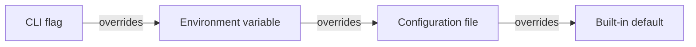

# Configuration reference

FakeAgents reads JSON or YAML. The file extension selects the decoder (`.json`, `.yaml`, `.yml`). Unknown fields are rejected so typos fail at startup instead of silently changing behaviour.

```bash
fakeagents serve -c configs/fakeagents.json
fakeagents validate -c configs/fakeagents.json
fakeagents config -c configs/fakeagents.json   # resolved config, secrets redacted
```

A configuration file is merged over the built-in defaults. You only need to set what you want to change. Explicit empty arrays replace the defaults (for example `"models": []`), while omitted fields keep their default value. Scenarios are the exception: they are additive unless `replace_builtin_scenarios: true`.

Every string in `templates`, and the scenario fields `respond.text`, `respond.reasoning`, `respond.raw_json`, `respond.tool_calls[].arguments_json`, and `defaults.tooling.argument_template`, accepts an `@file:` reference:

```json
{"templates": {"default": "@file:templates/assistant.md"}}
```

Paths are relative to the configuration file.

## Top level

| Key | Type | Default | Description |
|---|---|---|---|
| `$schema` | string | — | Optional editor schema URL |
| `server` | object | see below | Listener, timeouts, TLS, CORS |
| `logging` | object | see below | Structured logs |
| `auth` | object | `{"mode":"off"}` | API key validation |
| `required_headers` | array | `[]` | Required request headers |
| `defaults` | object | see below | Models, templates, timing, usage |
| `models` | array | built-in catalog | `GET /v1/models` entries |
| `media` | object | built-in fixtures | Image, speech file, and transcript fixtures |
| `templates` | map | `{}` | Named chat templates |
| `scenarios` | array | built-in scenarios | Behaviour rules |
| `scenario_files` | array | `[]` | Globs or directories of scenario files |
| `replace_builtin_scenarios` | bool | `false` | Start from only your scenarios |
| `rate_limit` | object | disabled | RPM/TPM throttling |
| `debug` | object | enabled | Inspection endpoints |
| `encryption` | object | ephemeral key | Reasoning signatures/encryption |
| `responses` | object | store on, 1h | Responses API persistence |
| `providers` | object | see below | Provider fidelity switches |

## `server`

```json
{
  "server": {
    "host": "127.0.0.1",
    "port": 11110,
    "base_path": "",
    "read_header_timeout": "10s",
    "read_timeout": "0s",
    "write_timeout": "0s",
    "idle_timeout": "120s",
    "shutdown_timeout": "15s",
    "max_body_bytes": 33554432,
    "tls": {"cert_file": "", "key_file": ""},
    "cors": {
      "enabled": true,
      "allowed_origins": ["*"],
      "allowed_methods": ["GET", "POST", "DELETE", "OPTIONS"],
      "allowed_headers": ["*"],
      "exposed_headers": ["*"],
      "allow_credentials": false,
      "max_age": "10m"
    }
  }
}
```

- `host`: `127.0.0.1` is the safe default. Use `0.0.0.0` in containers.
- `port`: `0` picks a free port; the actual URL is logged at startup.
- `base_path`: optional prefix, for example `/fakeagents`; health and debug endpoints move under it too.
- `write_timeout` must stay `0` for long streams. Use an idle timeout in the client instead.
- `max_body_bytes`: requests larger than this receive `413`.
- TLS is enabled when both files are present.

## `logging`

```json
{
  "logging": {
    "level": "info",
    "format": "text",
    "access_log": true,
    "output": "stdout"
  }
}
```

`level`: `debug`, `info`, `warn`, `error`. `format`: `text` or `json`. `output`: `stdout`, `stderr`, `discard`, or a file path (relative to the config file). Request bodies are never logged by default. Access logs include request ID, provider, endpoint, model, scenario, status, duration, TTFT, and token counts.

## `auth`

```json
{
  "auth": {
    "mode": "required",
    "accept_any": false,
    "keys": [
      {"key": "sk-fake", "name": "tests", "providers": ["openai"]}
    ],
    "exempt_paths": ["/healthz", "/_fakeagents/*"]
  }
}
```

- `off`: no checks.
- `optional`: a missing key is allowed, a presented key must be valid.
- `required`: a valid key is mandatory.

Keys are accepted from `Authorization: Bearer <key>`, `Authorization: <key>`, or `x-api-key: <key>`. `accept_any` accepts any non-empty credential without checking the list. `providers` limits a key to a provider; empty means both. Health and debug endpoints are exempt by default.

## `required_headers`

```json
{
  "required_headers": [
    {
      "name": "x-opencode-session",
      "enabled": true,
      "providers": ["openai"],
      "endpoints": ["chat.completions"],
      "paths": ["/v1/chat/*"],
      "methods": ["POST"],
      "allow_empty": false,
      "status": 400,
      "type": "invalid_request_error",
      "code": "missing_required_header",
      "message": "Missing required header: x-opencode-session",
      "exempt_paths": ["/healthz"]
    }
  ]
}
```

All populated filters must pass. A missing header produces a provider-native error envelope with the configured status, type, code, and message. Rules without `endpoints` apply to every `/v1/*` API endpoint, but never to health or debug endpoints.

This is how clients such as OpenCode are reproduced. A rule scoped to `chat.completions` only affects the OpenAI-compatible surface and leaves Codex (Responses) and Claude Code (Messages) untouched.

## `defaults`

```json
{
  "defaults": {
    "provider": "openai",
    "model": "fake-gpt-4o",
    "max_output_tokens": 1024,
    "strict_models": false,
    "respect_max_tokens": true,
    "session_headers": [
      "x-fakeagents-session",
      "x-opencode-session",
      "x-session-id",
      "x-conversation-id"
    ],
    "scenario": "",
    "thinking": {"mode": "mirror", "template": "reasoning", "redacted": false},
    "tooling": {
      "mode": "smart",
      "plan": [],
      "unknown_tool": "allow",
      "argument_strategy": "schema",
      "arguments": {"get_weather": {"city": "Jakarta"}},
      "argument_template": "",
      "max_tool_calls": 8,
      "include_reasoning": true,
      "final_after_tool_results": true,
      "final_template": "final"
    },
    "usage": {
      "mode": "computed",
      "multiplier": 1,
      "simulate_cache": true,
      "cache_tokens": 1024
    },
    "stream": {"chunk_size": 24, "chunk_unit": "runes"},
    "latency": {
      "enabled": true,
      "time_to_first_token": {"min": "20ms", "max": "60ms"},
      "tokens_per_second": {"min": 150, "max": 400}
    },
    "structured_output": {"mode": "auto"}
  }
}
```

- `strict_models`: when true, unknown models return 404 `model_not_found`. Generation requests also check estimated input against the model's context window and check explicit output token limits. For models with a capability list, tool requests require the `tools` capability. When false (default), any model string is echoed and served.
- `respect_max_tokens`: truncate generated output at the request's `max_tokens` / `max_output_tokens`, producing `finish_reason: length` and `status: incomplete`. Disable to always return the full fixture.
- `session_headers`: first non-empty header becomes the session key. Used for turn counters, template `.Turn`, rate limiting, and prompt-cache simulation.
- `scenario`: forces a scenario when the request has no explicit `X-FakeAgents-Scenario` or directive. Auto-matching is skipped while this is set.
- `thinking.mode`: `mirror` (emit reasoning only when requested), `always`, `never`.
- `thinking.redacted`: emit Anthropic `redacted_thinking` / hidden reasoning.
- `tooling.mode`: `smart`, `always`, `never`, or `agent`. `smart` calls tools only for an explicit `tool_choice`; `always` calls the first tool on every non-final turn; `agent` walks `tooling.plan` or the request's `tools[]` across turns until the plan is exhausted.
- `tooling.argument_strategy`: `schema`, `static`, or `template`.
- `tooling.plan`: ordered tool names for agent mode. When empty, the request's `tools[]` order is used.
- `tooling.unknown_tool`: `allow`, `skip`, or `error` when a plan entry is not declared in `tools[]`.
- `tooling.include_reasoning`: include a reasoning block before a tool call.
- `tooling.max_tool_calls`: maximum number of tool calls emitted by one response (default 8).
- `tooling.final_after_tool_results`: return final text when the last message is a tool result.
- `usage.mode`: `computed`, `zero`, or `fixed`.
- `usage.simulate_cache`: when the request carries a cache hint (`prompt_cache_key`, `cache_control`, `previous_response_id`), report cache-write tokens on turn 0 and cache-read tokens afterwards.
- `stream.chunk_size` and `chunk_unit`: `runes` or `words`; chunk boundaries never split UTF-8.
- `stream.chunk_delay`: fixed delay between frames, in addition to the configured tokens-per-second rate.
- `stream.include_usage`: force a usage frame for Chat Completions even when the client did not ask for it.
- `stream.send_done`: emit terminal events (`[DONE]`, `response.completed`, `message_stop`). Disable to test clients that wait for EOF.
- `latency.time_to_first_token`: range or fixed duration.
- `latency.tokens_per_second`: range or fixed number.
- `structured_output.mode`: `auto` synthesizes a schema-valid JSON object for `json_schema`/`json_object` requests; `text` leaves the template output untouched.

## `models`

```json
{
  "models": [
    {
      "id": "fake-gpt-4o",
      "provider": "openai",
      "display_name": "Fake GPT-4o",
      "owned_by": "fakeagents",
      "created": 1700000000,
      "context_window": 128000,
      "max_output_tokens": 16384,
      "capabilities": ["chat", "tools", "vision"],
      "aliases": ["gpt-4o"],
      "reasoning": false
    }
  ]
}
```

`provider` may be `openai`, `anthropic`, or `both`. Aliases resolve to the canonical ID when `strict_models` is enabled and are also accepted by `GET /v1/models/{id}`.

Optional `pricing` contains non-negative decimal strings in USD per token. OpenRouter-style responses use these strings, and the Models.dev registry converts prompt, completion, and cache rates to USD per million tokens. See [model-catalog.json](../configs/model-catalog.json) for priced and free fixtures.

## `templates`

Named templates override built-ins:

```json
{
  "templates": {
    "default": "You said: {{ .UserMessage }}\n\n— {{ .Model }}",
    "brief": "{{ truncate 80 .UserMessage }}",
    "json": "{\"answer\":{{ json .UserMessage }}}"
  }
}
```

Built-ins: `default`, `echo`, `reasoning`, `final`, `refusal`, `json`, `long`, `markdown`, `code`, `unicode`, `empty`. See [templates.md](templates.md).

## `scenarios` and `scenario_files`

```json
{
  "scenarios": [
    {
      "name": "billing",
      "match": {"triggers": ["billing", "quota"]},
      "respond": {"type": "error", "error": {"preset": "billing"}}
    }
  ],
  "scenario_files": ["scenarios/*.json", "more-scenarios/"]
}
```

Scenarios can also define `respond.steps` for multi-turn tool scripts. See [scenarios.md](scenarios.md#agentic-multi-turn-scripts).

Scenario files may contain an array or `{"scenarios": [...]}`. Paths are relative to the configuration file; directory paths load all `.json`/`.yaml`/`.yml` files.

Scenarios are **additive by default**: scenarios from `scenarios` and `scenario_files` are appended to the built-in list, and your scenario wins if it reuses a built-in name or trigger. Set `replace_builtin_scenarios: true` to start from only the scenarios in your files. See [scenarios.md](scenarios.md).

## `rate_limit`

```json
{
  "rate_limit": {
    "enabled": true,
    "scope": "session",
    "requests_per_minute": 60,
    "tokens_per_minute": 20000,
    "retry_after": "1s",
    "include_headers": true,
    "exempt_paths": ["/healthz", "/_fakeagents/*"]
  }
}
```

A token bucket is evaluated per session (default) or globally. Request limits are checked before the handler; token limits use the estimated input token count after parsing. Exceeding either returns a provider-native 429 with `Retry-After` and `x-ratelimit-*` / `anthropic-ratelimit-*` headers.

## `debug`

```json
{
  "debug": {
    "enabled": true,
    "headers": true,
    "record_tools": false,
    "max_recorded_requests": 200
  }
}
```

Debug endpoints: `/healthz`, `/_fakeagents/{version,scenarios,config,requests,sessions,active,reset}`. Disable them on shared or public hosts. `headers` adds `X-FakeAgents-*` response headers. `record_tools` captures each request's harness tool catalog under `tools` in `/_fakeagents/requests` (opt-in, because tool schemas may contain sensitive descriptions).

## `encryption`

```json
{"encryption": {"key": "base64-or-passphrase", "validate_replay": true}}
```

A 32-byte base64 key is recommended. Without a key, an ephemeral random key is generated at startup, so encrypted reasoning and thinking signatures cannot be replayed across restarts. `validate_replay` rejects tampered OpenAI `encrypted_content` and Anthropic thinking signatures with 400 errors.

## `responses`

```json
{"responses": {"store": true, "ttl": "1h", "max_entries": 1000}}
```

Controls the in-memory Responses API store used by `previous_response_id`, `GET /v1/responses/{id}`, and `DELETE`. Records are evicted by TTL and by size (oldest first).

## `providers`

```json
{
  "providers": {
    "openai": {
      "chat_reasoning_field": "reasoning_content",
      "system_fingerprint": "fp_fakeagents",
      "validate_encrypted_content": true
    },
    "anthropic": {
      "require_version": true,
      "api_version": "2023-06-01",
      "stream_ping": true,
      "validate_signatures": true
    }
  }
}
```

- `chat_reasoning_field`: `reasoning_content` (DeepSeek/OpenAI-compatible convention), `reasoning`, `both`, or `none`.
- `require_version`: require the `anthropic-version` header. Disable for lenient clients.
- `stream_ping`: emit an Anthropic `ping` event after `message_start`.
- `validate_encrypted_content` / `validate_signatures`: verify replayed opaque reasoning blobs.

## Environment variables and flags

| Flag | Environment | Overrides |
|---|---|---|
| `-c`, `--config` | `FAKEAGENTS_CONFIG` | Config file path |
| `--host` | `FAKEAGENTS_HOST` | `server.host` |
| `--port` | `FAKEAGENTS_PORT` | `server.port` |
| `--log-level` | `FAKEAGENTS_LOG_LEVEL` | `logging.level` |
| `--log-format` | `FAKEAGENTS_LOG_FORMAT` | `logging.format` |
| `--scenario` | `FAKEAGENTS_SCENARIO` | `defaults.scenario` |
| `--require-header` | `FAKEAGENTS_REQUIRE_HEADERS` | Appends a header rule |
| `--strict` | — | `defaults.strict_models` |
| `--no-latency` | — | `defaults.latency.enabled` |
| `--print-config` | — | Print resolved config and exit |
| — | `FAKEAGENTS_AUTH_MODE` | `auth.mode` |

Higher-priority values override lower-priority ones:



## Multiple scenario files

```json
{
  "scenario_files": [
    "scenarios/core/*.json",
    "scenarios/experiments/*.yaml"
  ]
}
```

`fakeagents validate` compiles every scenario, compiles every template, and checks every file reference before the server starts.
