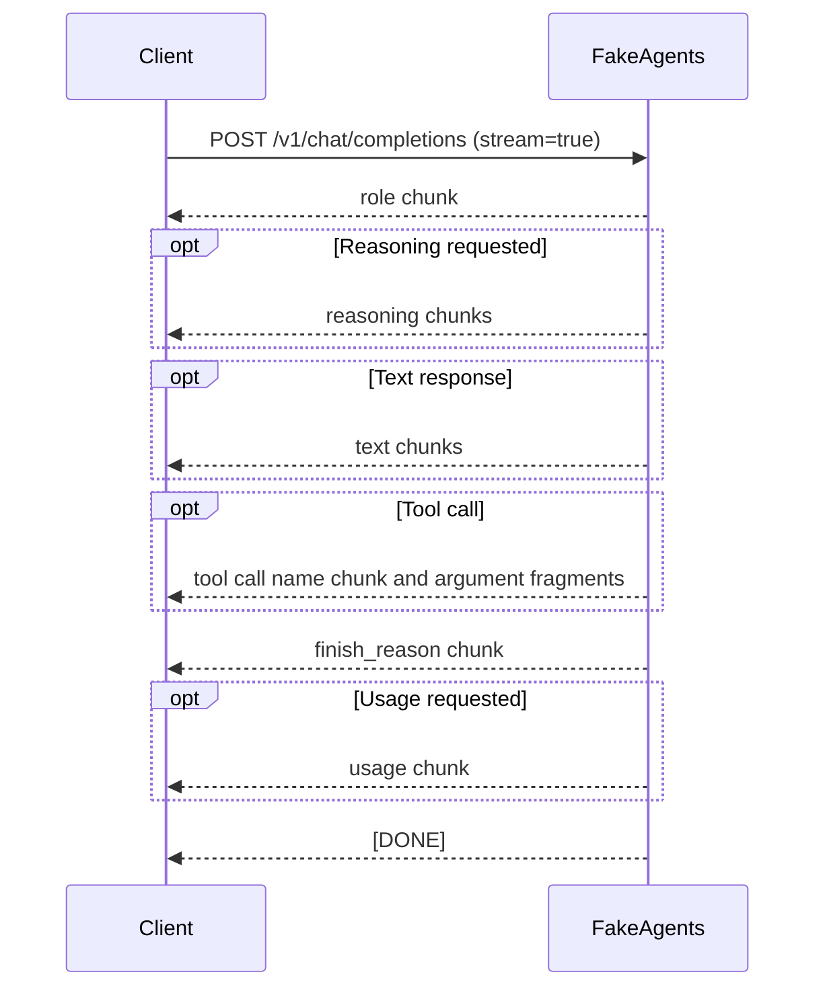
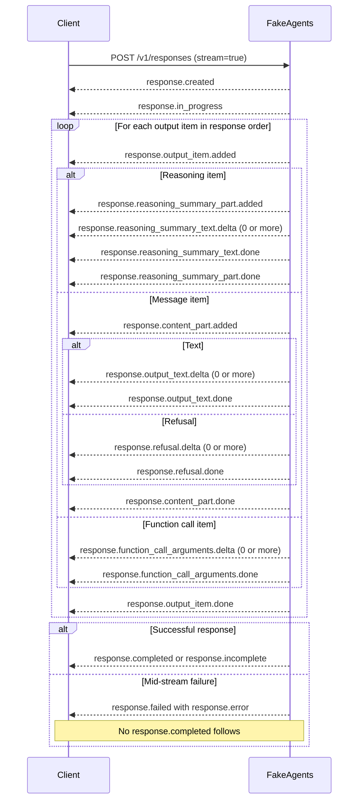
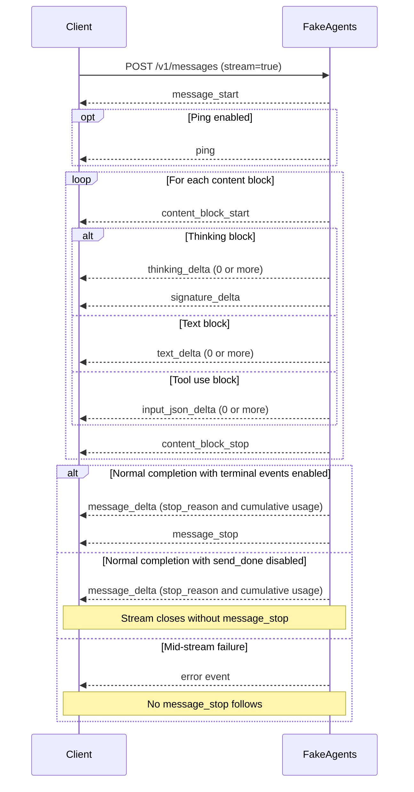

# Provider fidelity

FakeAgents implements the wire formats, not the models. This page describes exactly what each surface accepts and returns so adapter code can be written against realistic fixtures.

## Model discovery

All views use the configured model IDs, limits, and capabilities. Start the sample catalog with `make build`, then run:

```bash
./bin/fakeagents serve -c configs/model-catalog.json
```

| View | Request | Behavior |
|---|---|---|
| OpenAI | `GET /v1/models` | Basic ID, owner, and creation time |
| Anthropic | `GET /v1/models` with `anthropic-version` | Newest first, with `limit`, `after_id`, and `before_id` |
| OpenRouter-style | `GET /api/v1/models` | Prices, context and output limits, modalities, and supported parameters for OpenAI-compatible models. Supports `offset`, `limit`, `supported_parameters`, and `output_modalities`. |
| Models.dev | `GET /api.json` | The `fakeagents` provider and its OpenAI-compatible model metadata for OpenCode |

```bash
curl 'http://127.0.0.1:11110/api/v1/models?limit=1&supported_parameters=tools'
curl -H 'anthropic-version: 2023-06-01' 'http://127.0.0.1:11110/v1/models?limit=1'
OPENCODE_MODELS_URL=http://127.0.0.1:11110 FAKEAGENTS_API_KEY=fake-dev \
  opencode models fakeagents --refresh --verbose
```

Use `GET /api/v1/model/fake-lab/pro` for OpenRouter-style lookup. `POST /api/v1/chat/completions` uses the OpenAI Chat simulator. The OpenRouter-style catalog covers discovery and the listed filters. The fixture enables `strict_models` so the text-only model can exercise context overflow, excessive output limits, and unsupported tools.

OpenRouter-compatible streaming is also available at `/api/v1/chat/completions`
and `/api/v1/responses`. For Chat, the stream sends the finish chunk, a final
usage chunk with a choice repeating `finish_reason` and `native_finish_reason`,
then `[DONE]`. This usage chunk is sent even when `include_usage` is omitted.
The Responses stream includes usage in `response.completed` or
`response.incomplete`, followed by `[DONE]`. The `/v1` endpoints use the
OpenAI-style terminal events documented below.

OpenRouter-style usage reports simulated cache reads, cache writes, and cost.
Cost is calculated using the configured model `pricing` per-token values and
the simulated token counts. Missing prices default to zero. Fault scenarios
that suppress the terminal event also suppress `[DONE]`.

## OpenAI Chat Completions

`POST /v1/chat/completions`

Accepted request fields include:

- `model`, `messages`, `stream`, `stream_options.include_usage`
- `tools`, `tool_choice` (`auto`, `none`, `required`, named function)
- `max_tokens` or `max_completion_tokens` (not both)
- `temperature`, `top_p`, `response_format`, `stop`
- `reasoning_effort`, `reasoning.effort`, `reasoning.summary`
- compatible thinking flags: `thinking.type`, `enable_thinking`
- `prompt_cache_key`, `user`, `metadata`, `n`, `store`

Content may be a string or parts: `text`, `input_text`, `output_text`, `refusal`, `image_url`, `input_image`, `input_audio`, `audio`, `file`. Image/audio/file parts are counted as placeholders; FakeAgents does not process media.

`n > 1` and sending both token-limit fields return 400.

Reasoning is returned according to `providers.openai.chat_reasoning_field`:

```json
{
  "role": "assistant",
  "content": "…",
  "reasoning_content": "…",
  "tool_calls": []
}
```

`reasoning_content` is the DeepSeek/OpenRouter convention; `reasoning` is the normalized field used by several gateways. Set `both` to emit both, or `none` to hide reasoning while still billing reasoning tokens.

Streaming chunk order:



`finish_reason`: `stop`, `length`, `tool_calls`, or `content_filter`. `content` is `null` when the response contains only tool calls. A refusal is returned through `message.refusal` with `finish_reason: "stop"`.

## OpenAI Responses

`POST /v1/responses`

`input` may be a string, or an array of:

- message items (`type: "message"`, or role-only items)
- `function_call` items
- `function_call_output` items
- `reasoning` items with `summary` and `encrypted_content`
- built-in tool activity items (ignored)

Other supported fields: `instructions`, `tools`, `tool_choice`, `max_output_tokens`, `reasoning.effort`, `reasoning.summary`, `text.format`, `include`, `stream`, `store`, `previous_response_id`, `prompt_cache_key`, `parallel_tool_calls`, `temperature`, `top_p`, `metadata`, `user`, `truncation`. `background: true` and `item_reference` return explicit 400 errors.

### Output items

```json
{
  "output": [
    {
      "type": "reasoning",
      "id": "rs_…",
      "summary": [{"type": "summary_text", "text": "…"}],
      "encrypted_content": "fa1.…",
      "status": "completed"
    },
    {
      "type": "message",
      "id": "msg_…",
      "role": "assistant",
      "status": "completed",
      "content": [
        {"type": "output_text", "text": "…", "annotations": [], "logprobs": []}
      ]
    },
    {
      "type": "function_call",
      "id": "fc_…",
      "call_id": "call_…",
      "name": "get_weather",
      "arguments": "{\"city\":\"example\"}",
      "status": "completed"
    }
  ]
}
```

Never assume `output[0]` is the message: reasoning items appear first, and a response can contain multiple message/function-call items.

`status` is `completed` or `incomplete`. The latter sets `incomplete_details.reason` to `max_output_tokens`.

### Streaming



Function calls stream through `response.function_call_arguments.delta` / `.done`. Refusals use `response.refusal.delta` / `.done`.

Every event carries `type` and an increasing `sequence_number`. A deliberate mid-stream failure ends with `response.failed` and a `response.error` object; no `response.completed` follows.

### Encrypted reasoning

Requesting `include: ["reasoning.encrypted_content"]` adds an opaque `encrypted_content` blob to the reasoning item. Send it back on the next request to simulate stateless/ZDR reasoning replay. FakeAgents authenticates the blob with AES-GCM and rejects tampered values with `400 invalid_encrypted_content`.

`previous_response_id` prepends the stored input and output items before parsing the new request. `instructions` are not carried over — send them every turn, exactly like the real API.

### Store endpoints

- `GET /v1/responses/{id}`
- `DELETE /v1/responses/{id}`

Storage is in memory, bounded by `responses.max_entries`, and expires after `responses.ttl`.

## Anthropic Messages

`POST /v1/messages`

Headers:

- `x-api-key` (or `Authorization: Bearer`)
- `anthropic-version` — required by default; configurable via `providers.anthropic.require_version`

The body requires `max_tokens`. `system` may be a string or an array of text blocks. Messages accept string content or blocks:

- `text`, `image`, `document`
- `tool_use` (`id`, `name`, `input`)
- `tool_result` (`tool_use_id`, `content`, `is_error`)
- `thinking` (`thinking`, `signature`)
- `redacted_thinking` (`data`)
- `search_result`, `container_upload` (accepted/ignored)

`tools` use `{name, description, input_schema}`. `tool_choice` supports `auto`, `any`, `tool`, and `none`. `thinking` supports `enabled` (with `budget_tokens`), `adaptive`, and `disabled`, plus `display: summarized|omitted`. `output_config` supports `effort` and `format: {type: "json_schema", schema}`. `metadata.user_id`, `stop_sequences`, `cache_control`, and `stream` are honored.

Validation errors that matter for tests:

- missing `max_tokens` → 400 `max_tokens: Field required`
- missing `anthropic-version` → 400
- `thinking.budget_tokens < 1024` → 400
- `budget_tokens >= max_tokens` → 400
- modified thinking signature → 400 “thinking blocks cannot be modified”

### Response blocks

```json
{
  "id": "msg_…",
  "type": "message",
  "role": "assistant",
  "model": "fake-claude-sonnet",
  "content": [
    {"type": "thinking", "thinking": "…", "signature": "fa1.…"},
    {"type": "text", "text": "…"},
    {"type": "tool_use", "id": "toolu_…", "name": "get_weather", "input": {"city": "example"}}
  ],
  "stop_reason": "end_turn",
  "stop_sequence": null,
  "usage": {
    "input_tokens": 10,
    "output_tokens": 40,
    "cache_creation_input_tokens": 0,
    "cache_read_input_tokens": 0,
    "cache_creation": {"ephemeral_5m_input_tokens": 0, "ephemeral_1h_input_tokens": 0},
    "output_tokens_details": {"thinking_tokens": 20}
  }
}
```

`stop_reason`: `end_turn`, `max_tokens`, `tool_use`, `stop_sequence`, or `refusal`.

When `thinking.display` is `omitted`, the thinking block has empty `thinking` text but still carries a full signature, matching the current Anthropic contract.

### Streaming



`message_delta.usage` is cumulative. `signature_delta` is a single event immediately before the thinking block closes. Mock signatures are authenticated with the same key as OpenAI encrypted content; replay them unmodified.

`defaults.stream.send_done: false` suppresses `message_stop`, `[DONE]`, and `response.completed` to simulate a stream that closes without a terminal event.

A mid-stream failure arrives as an `error` event after HTTP 200. No `message_stop` follows.

### Token counting

`POST /v1/messages/count_tokens` accepts the same body shape (without requiring `max_tokens`) and returns:

```json
{"input_tokens": 123}
```

## Image and audio fixtures

`POST /v1/images/generations` accepts JSON with `model`, `prompt`, `n`,
`size`, `quality`, `background`, `output_format`, `stream`, and
`partial_images`. It returns valid base64 PNG or JPEG images. The deterministic
image color derives from the prompt. Set `media.image_file` to a local PNG or JPEG fixture to return that image scaled to the requested size. Relative paths resolve from the config file. `POST /v1/images/edits` accepts multipart
`image` or `image[]` uploads and `prompt`. The result is a generated fixture,
so the pixels do not reproduce an edit of the source. Streaming emits
`image_generation.partial_image` / `image_generation.completed` or their
`image_edit` equivalents. URL results, WebP output and JSON image references
are not implemented. The accepted size range is a simulator constraint, not model-specific OpenAI validation.

`POST /v1/audio/speech` accepts JSON `model`, `voice`, `input`, and
`response_format`. The embedded audio says “Hello. This is simulated speech
from Fake Agents.” regardless of the input. Formats are MP3, WAV, PCM, AAC,
Opus and FLAC. To replace a fixture, set `media.speech_files` to a map from
format to a file path; relative paths are resolved relative to the config file.
The fixture must already be encoded in the selected format. `stream_format: "sse"` is not implemented.

```json
{
  "media": {
    "image_file": "./fixtures/result.png",
    "speech_files": {
      "mp3": "./fixtures/voice.mp3",
      "wav": "./fixtures/voice.wav"
    },
    "transcription": "Transkrip untuk pengujian."
  }
}
```

`POST /v1/audio/transcriptions` accepts a multipart `file` and `model`.
It returns the configured `media.transcription`, defaulting to
“This is a simulated transcription.” Text, JSON, SRT, VTT and verbose JSON are
available, along with JSON transcription SSE. A matching scenario's text can
override the transcript. Audio is checked for a recognizable container header;
it is not transcribed. Timestamps in subtitle fixtures are fixed at 0–1 second.

The four endpoints participate in scenario selection using
`images.generations`, `images.edits`, `audio.speech`, and
`audio.transcriptions`. The default strict model catalog contains chat models,
so configure media model IDs when `strict_models` is enabled.

## Usage accounting

FakeAgents estimates tokens deterministically from characters, words, CJK runes, message overhead, and tool schemas. It is stable, not byte-identical to a provider tokenizer.

- OpenAI `prompt_tokens` includes cached and cache-write tokens.
- Anthropic `input_tokens` excludes cache tokens, which are reported separately.
- Reasoning tokens are always billed, even when hidden.
- `defaults.usage` and per-scenario overrides can force exact numbers.

Prompt-cache simulation: when a request carries `prompt_cache_key`, `cache_control`, or `previous_response_id`, turn 0 reports cache writes and later turns report cache reads. Disable with `usage.simulate_cache: false`.

## Errors and rate limits

OpenAI errors:

```json
{"error": {"message": "…", "type": "…", "param": null, "code": "…"}}
```

Anthropic errors:

```json
{"type": "error", "error": {"type": "…", "message": "…"}, "request_id": "req_…"}
```

Headers on every response:

- OpenAI: `x-request-id`, `openai-version`, `x-ratelimit-*`
- Anthropic: `request-id`, `anthropic-version`, `anthropic-ratelimit-*`
- Both: `X-FakeAgents-Step`, `X-FakeAgents-Turn`, `X-FakeAgents-Scenario`, `X-FakeAgents-Session` (when debug headers are enabled)

## Client notes

### Codex CLI

Codex requires the Responses API:

```toml
model = "gpt-5.4"
model_provider = "fakeagents"

[model_providers.fakeagents]
base_url = "http://127.0.0.1:11110/v1"
env_key = "OPENAI_API_KEY"
wire_api = "responses"
```

### Claude Code

```bash
export ANTHROPIC_BASE_URL=http://127.0.0.1:11110
export ANTHROPIC_AUTH_TOKEN=sk-ant-fake
export ANTHROPIC_API_KEY=sk-ant-fake
export ANTHROPIC_MODEL=claude-sonnet-4-5
claude -p "Hello" --model claude-sonnet-4-5 --output-format text
```

### OpenCode 1.x

```json
{
  "provider": {
    "fakeagents": {
      "npm": "@ai-sdk/openai-compatible",
      "options": {
        "baseURL": "http://127.0.0.1:11110/v1",
        "apiKey": "sk-fake",
        "headers": {"x-opencode-session": "local"}
      },
      "models": {"fake-gpt-4o": {}}
    }
  }
}
```

Combine with a required-header rule scoped to `chat.completions` to prove the client sends `x-opencode-session`.

## Known limitations

- No real inference; templates decide the content.
- Media output is simulated using deterministic fixtures. Video, embeddings, batches, fine-tuning, and realtime APIs are out of scope.
- Responses `item_reference`, background responses, and `n > 1` are rejected.
- Encrypted blobs and signatures are FakeAgents-specific.
- Cache hit/miss behaviour is simulated, not a real prefix cache.
- Model catalogs are generated from local configuration. See [model discovery](#model-discovery) for supported catalog queries.
