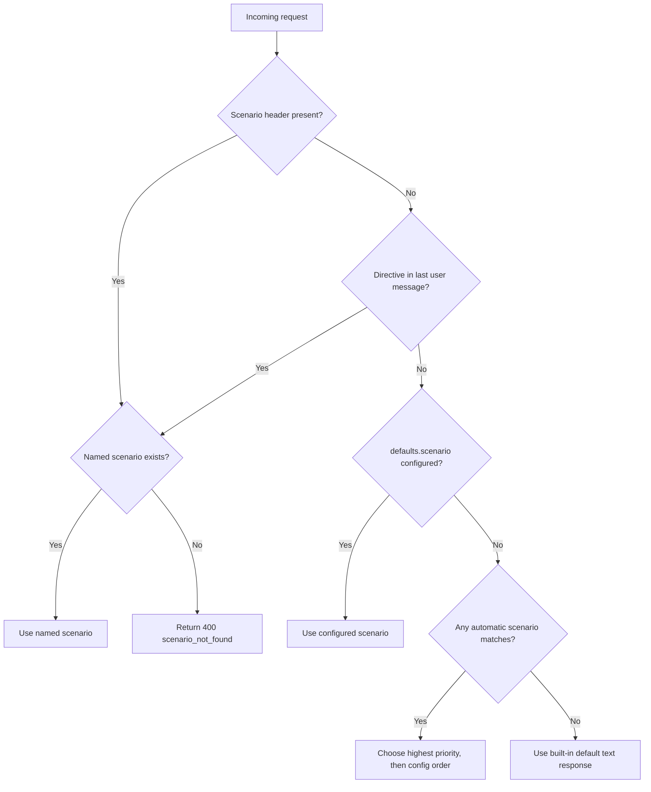
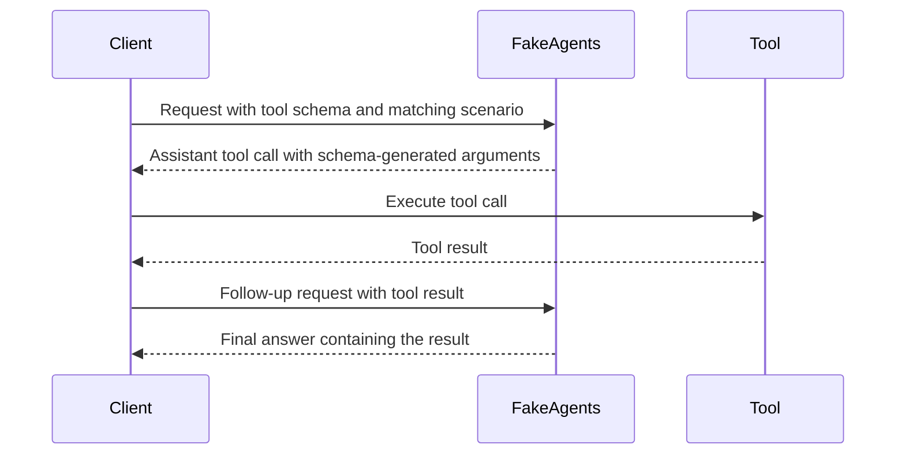

# Scenarios

A scenario is a declarative rule: **match a request, then simulate a response or a failure**. Scenarios are evaluated per request and can be selected explicitly or matched automatically.

## Selection order



Names and trigger aliases are case-insensitive. An unknown explicit name returns `400 scenario_not_found` and lists the available names.

Directives are removed before template rendering, so `[[fakeagents:billing]]` never leaks into the answer.

> **Named-only scenarios never hijack traffic.** A scenario with no match criteria is only selectable by name or trigger. Add criteria to make it automatic.

Custom scenarios are **appended to the built-ins** by default. If your scenario name or one of its triggers collides with a built-in, your scenario replaces it. Set `replace_builtin_scenarios: true` to start from an empty list.

## `match`

All populated criteria must pass. Values inside a list are OR-ed.

| Field | Type | Meaning |
|---|---|---|
| `providers` | `["openai","anthropic"]` | Provider |
| `endpoints` | `["chat.completions","responses","messages","count_tokens","models"]` | Endpoint |
| `models` | glob list | Model ID; `*` and `?` supported |
| `roles` | list | Last message role (`user`, `assistant`, `tool`) |
| `stream` | bool | Streaming request |
| `thinking` | bool | Client requested reasoning |
| `has_tools` | bool | Tools were provided |
| `has_tool_results` | bool | Last message is a tool result |
| `headers` | map | Exact header values (case-insensitive names) |
| `header_regex` | map | Regex per header |
| `header_present` | list | Header must be non-empty |
| `json_equals` | map | Dotted JSON path equals a value |
| `json_regex` | map | Dotted JSON path matches a regex |
| `json_exists` | list | Dotted JSON path exists |
| `json_count` | list | Count values selected by a dotted path with `*` array segments, optional field filters, and `min`/`max` bounds |
| `user_regex` | regex | Last user message |
| `system_regex` | regex | System/instructions |
| `turn` | int | Exact 0-based session turn |
| `probability` | 0..1 | Random gate after all other criteria |
| `triggers` | list | Alternative names for explicit selection |
| `priority` | int | Higher wins; ties use config order |

JSON paths use dots and array indexes: `reasoning.effort`, `messages.0.content`, `tools.0.function.name`.

`json_count` can test repeated request parts. Its `path` selects values from
the incoming JSON body, and each `*` expands one array level. `where`
compares fields relative to each selected value. `exists` requires fields to
be present. `empty` matches fields that are absent, null, or the empty string.
All filters on a selected value must match. `min` and `max` are inclusive.

The ready-to-run [custom rules example](../configs/custom-rules.json) includes
an image limit and a simulated missing-thinking error. For example, the first
rule returns a configured 400 error when a request for `glm-5.3-flash`
contains 33 or more `image_url` parts across Chat messages. The second rule
targets assistant tool calls on `deepseek-v4*` when `reasoning_content` is
absent, null, or empty and tools are provided. A value of `"."` passes this
example's check. The model names, limit, status, error message, filters, and
response are configurable fixtures.

```bash
./bin/fakeagents serve -c configs/custom-rules.json
```

The example counts direct Chat content parts. Other wire shapes can be
matched with their own paths, such as `input.*.content.*` for Responses
or `messages.*.content.*` with type `image` for Anthropic Messages.

```json
{
  "name": "gpt-5-high-effort-is-overloaded",
  "priority": 100,
  "match": {
    "providers": ["openai"],
    "endpoints": ["responses"],
    "models": ["gpt-5*"],
    "json_equals": {"reasoning.effort": "high"},
    "stream": true
  },
  "respond": {
    "type": "error",
    "error": {"preset": "overloaded"}
  }
}
```

## `respond`

### Types

| Type | Behaviour |
|---|---|
| `text` | Normal assistant text (default) |
| `reasoning` | Forces a thinking block, then a normal answer |
| `tool_call` | Emits a tool call; automatically final after a tool result |
| `refusal` | Refusal text + provider-native refusal semantics |
| `empty` | Empty content with a normal stop reason |
| `error` | Provider-native error before streaming starts |
| `raw` | Full raw JSON body (non-streaming only) |

### Common fields

```json
{
  "type": "text",
  "text": "Inline Go template",
  "text_template": "named-template",
  "variants": ["First style", "Second style {{ .Model }}"],
  "thinking": true,
  "reasoning": "Custom reasoning template",
  "reasoning_template": "reasoning",
  "redacted_reasoning": false,
  "tool_calls": [
    {"name": "get_weather", "arguments": {"city": "Jakarta"}},
    {"name": "broken_tool", "arguments_json": "{\"city\": "}
  ],
  "finish": "stop",
  "stop_sequence": "",
  "headers": {"x-fixture": "billing"},
  "usage": {"mode": "fixed", "input_tokens": 100, "output_tokens": 50},
  "latency": {"time_to_first_token": "2s", "tokens_per_second": 2},
  "stream": {
    "chunk_size": 8,
    "chunk_unit": "words",
    "chunk_delay": "50ms",
    "omit_usage": false,
    "omit_done": false,
    "send_pings": true
  }
}
```

- `text_template` refers to a named template. `text` is inline template source.
- `variants` picks one variant using the request's deterministic RNG.
- Explicit `text`, `text_template`, or `variants` always wins over automatic final/structured output.
- `tool_calls[].arguments` is a static object. `arguments_json` is a template and may be malformed on purpose.
- `finish`: `stop`, `length`, `tool_calls`, `content_filter`, `refusal` (Anthropic aliases `end_turn`, `max_tokens`, `tool_use` are accepted).
- `headers` are added to the provider response.
- `usage` overrides computed token counts. `mode: "fixed"` zeroes anything not supplied.
- `latency` overrides the global timing for this scenario (when `defaults.latency.enabled` is true).
- `stream` overrides chunking and can inject failures.

### Error preset

```json
{
  "type": "error",
  "error": {
    "preset": "billing",
    "status": 429,
    "message": "Custom message",
    "code": "custom_code",
    "retry_after": "2s",
    "headers": {"x-request-id": "upstream-123"}
  }
}
```

Presets are provider-aware:

| Preset | OpenAI | Anthropic |
|---|---|---|
| `billing` | 429 `insufficient_quota` | 402 `billing_error` |
| `authentication` | 401 `invalid_api_key` | 401 `authentication_error` |
| `permission` | 403 | 403 `permission_error` |
| `not_found` | 404 | 404 `not_found_error` |
| `model_not_found` | 404 `model_not_found` | 404 `not_found_error` |
| `rate_limit` | 429 `rate_limit_exceeded` | 429 `rate_limit_error` |
| `overloaded` | 503 | 529 `overloaded_error` |
| `server_error` | 500 | 500 `api_error` |
| `timeout` | 504 | 504 `timeout_error` |
| `invalid_request` | 400 | 400 `invalid_request_error` |
| `context_length` | 400 `context_length_exceeded` | 400 `invalid_request_error` |
| `request_too_large` | 413 | 413 `request_too_large` |
| `content_policy` | 400 | 400 |
| `conflict` | 409 | 409 `conflict_error` |

Any field can override the preset. `retry_after` becomes a `Retry-After` header.

### Streaming faults

```json
{
  "name": "stream-error",
  "match": {"stream": true},
  "respond": {
    "stream": {
      "fail_after_chunks": 3,
      "error": {"preset": "overloaded"},
      "abort_after_chunks": 0,
      "omit_done": false
    }
  }
}
```

- `fail_after_chunks`: after N emitted SSE frames, send a provider-native error (`data: {"error":...}` for OpenAI Chat, `event: error` for Anthropic, `response.failed` for Responses). The HTTP status is already 200.
- `abort_after_chunks`: close the stream with no error and no terminal event.
- `omit_usage`: suppress the final usage frame.
- `omit_done`: suppress `[DONE]` (Chat), `response.completed` (Responses), or `message_stop` (Messages).
- `send_pings`: Anthropic `ping` events.

## Agentic multi-turn scripts

`respond.steps` turns one scenario into a deterministic turn script. This is how you simulate a real agent loop — tool call, tool result, another tool call, final answer — without state on the server or one scenario per turn.

> **Safety:** these are simulated tool calls, but a real harness executes them.
> A scenario step can therefore run a real command with the harness's
> permissions. Treat scenario files as executable policy and use a disposable
> container. See [SECURITY.md](../SECURITY.md).

```json
{
  "name": "tool-error",
  "match": {"user_regex": "(?i)test tool error"},
  "respond": {
    "thinking": true,
    "steps": [
      {"tool_calls": [{"tool_index": 0}]},
      {"tool_calls": [{"name": "missing_tool", "arguments_json": "{\"broken\": "}]},
      {"text": "Tool result: {{ .LastToolResult }}\n\nFinal answer."}
    ]
  }
}
```

The three requests look like:

1. User prompt → FakeAgents calls the first tool declared in the harness `tools[]` (`tool_index: 0`).
2. The client sends the assistant tool call plus the tool result → FakeAgents calls `missing_tool`, which is **not** in `tools[]`, with malformed JSON arguments.
3. The client sends the second tool call plus its result → FakeAgents returns the final text, which can use `.LastToolResult`.

### Step selection

Step selection is stateless and derived from the conversation by default (`steps_mode: auto`):

```text
step = number of assistant tool-call messages after the most recent user message
```

- A parallel tool turn counts once, no matter how many calls it contains.
- A new user prompt resets the script to step 0, so the same trigger can start a fresh run in the same session.
- If a client sends only a tool result without the assistant tool call, it is treated as step 1.
- Text that accompanies a `tool_result` (Anthropic) or `function_call_output` (Responses) belongs to the same agent turn and does not reset the script.
- `X-FakeAgents-Step: N` forces a step for deterministic tests.
- If the index is past the end, the last step is reused.
- The active step is exposed as `.Step` in templates, `X-FakeAgents-Step` in responses, and `step` in request logs.

This works across all three surfaces because OpenAI `tool_calls`, Responses `function_call` items, and Anthropic `tool_use` blocks are normalised into assistant tool-call turns.

### Step inheritance

Each step is a full response spec. These outer fields are inherited when the step leaves them empty:

`thinking`, `reasoning`, `reasoning_template`, `redacted_reasoning`, `finish`, `stop_sequence`, `usage`, `latency`, `stream`, `headers`, `agentic`, `tool_plan`, `unknown_tool`, `steps_mode`.

Text, tool calls, errors, and raw bodies are never inherited — each step decides its own action.

### Referring to harness tools

`tool_index` is a zero-based index into the request's `tools[]` array:

```json
{"tool_calls": [{"tool_index": 0, "arguments": {"city": "Jakarta"}}]}
```

- `name` wins when both `name` and `tool_index` are present.
- An out-of-range index resolves to `fakeagents_missing_tool_<index>` when no name is supplied, which is useful for testing clients that handle an unknown tool gracefully.
- `arguments` is a static object; `arguments_json` is a template and may be malformed on purpose. OpenAI Chat preserves malformed arguments as a string. Anthropic Messages requires an object, so malformed input falls back to `{}` there.

### Harness-driven agent mode

`agentic: true` makes a scenario walk the harness `tools[]` automatically:

```json
{
  "name": "agentic",
  "match": {"triggers": ["agent"]},
  "respond": {
    "agentic": true,
    "thinking": true
  }
}
```

The plan is, in order:

1. `respond.tool_plan`, if set.
2. `defaults.tooling.plan`, if set.
3. The request's `tools[]` names, in declaration order.

One plan entry is consumed per assistant turn. When the plan is exhausted, the response becomes final text. A plan entry that is not declared in `tools[]` is controlled by `unknown_tool`:

| Value | Behaviour |
|---|---|
| `allow` (default) | Emit the undeclared tool call with static or `{}` arguments |
| `skip` | Skip to a later declared tool, or finish |
| `error` | Return a provider-native 400 `tool_not_declared` error |

Set `defaults.tooling.mode: "agent"` to make this the default for every request, or use `[[fakeagents:agentic]]` for a one-off run. `tool_choice: "none"` still suppresses tool calls.

Use `X-FakeAgents-Step` when a test needs to jump directly to a specific turn.

### Stateful sequences, steering, and queued messages

The default step selection is stateless and tool-aware. For a queue, a slow turn that receives a steering message, or a sequence that advances on every request, set `steps_mode`:

| Mode | Step source | Best for |
|---|---|---|
| `auto` (default) | Assistant tool-call turns | Agent/tool loops |
| `request` | Session request index (`X-FakeAgents-Turn`/`.Turn`) | Simple per-request scripts |
| `sequence` | Stateful cursor keyed by session + scenario | Steering, queues, concurrent rooms |

`request` can be affected by auxiliary requests (for example a title-generation call), so use a narrow matcher or `X-FakeAgents-Step` when the client sends those.

`sequence` advances once per selected request:

```json
{
  "name": "queue-drain",
  "match": {"triggers": ["queue-drain"]},
  "respond": {
    "steps_mode": "sequence",
    "steps": [
      {"text": "Working on the first turn..."},
      {"text": "Steering message received: {{ .UserMessage }}"},
      {"text": "Queue drained. Final turn."}
    ]
  }
}
```

- The cursor is keyed by session + scenario. Use `X-FakeAgents-Session` (or a configured session header) to isolate rooms.
- Concurrent requests receive sequential steps; the exact order is lock acquisition order. Use `X-FakeAgents-Step` for deterministic control.
- Retries consume a step. `POST /_fakeagents/reset` clears all sequence cursors.
- A request forced with `X-FakeAgents-Step` reads that step without consuming the cursor.

The built-in `steering` scenario is a ready-made example: its first turn has a 500–800ms time to first token and 30 tokens/sec, while the queued/steering turns are fast. Start it with `[[fakeagents:steering]]` or `X-FakeAgents-Scenario: steering`.

```bash
# Room A: slow first turn.
curl -sS -N "$BASE/v1/chat/completions" \
  -H 'Content-Type: application/json' \
  -H 'x-fakeagents-session: room-a' \
  -H 'X-FakeAgents-Scenario: steering' \
  -d '{"model":"fake-gpt-4o","stream":true,"messages":[{"role":"user","content":"work on the long task"}]}'

# While that stream is open, send a steering message in the same room.
curl -sS "$BASE/v1/chat/completions" \
  -H 'Content-Type: application/json' \
  -H 'x-fakeagents-session: room-a' \
  -H 'X-FakeAgents-Scenario: steering' \
  -d '{"model":"fake-gpt-4o","messages":[{"role":"user","content":"steer: use the other approach"}]}'
```

The second answer contains the steering message. Use a second session (`room-b`) to run the same flow in parallel, and query `GET /_fakeagents/active` to observe both in-flight requests.

## Examples

### Billing exhausted by trigger

```json
{
  "name": "billing",
  "match": {"triggers": ["billing", "quota"]},
  "respond": {"type": "error", "error": {"preset": "billing"}}
}
```

```bash
curl http://127.0.0.1:11110/v1/chat/completions \
  -H 'Content-Type: application/json' \
  -d '{"model":"fake-gpt-4o","messages":[{"role":"user","content":"[[fakeagents:billing]]"}]}'
```

### Different answer per conversation turn

```json
{
  "name": "onboarding",
  "match": {"providers": ["openai"], "user_regex": "onboard"},
  "respond": {
    "variants": [
      "Welcome. What should I call you?",
      "Nice to meet you. What are you building?",
      "Got it. Let's start with the first step."
    ]
  }
}
```

Use `match.turn` for exact control:

```json
{
  "name": "third-turn-only",
  "match": {"turn": 2},
  "respond": {"text": "This is the third request in the session."}
}
```

### Tool loop

```json
{
  "name": "tool-call",
  "match": {"triggers": ["tool", "tool-call"]},
  "respond": {"type": "tool_call", "thinking": true}
}
```

The first request returns a schema-generated call for the first declared tool. The client runs it and sends its result in a follow-up request, which receives final text containing the result:



To use different arguments per tool:

```json
{
  "defaults": {
    "tooling": {
      "arguments": {
        "get_weather": {"city": "Jakarta", "unit": "celsius"},
        "search_docs": {"query": "streaming"}
      }
    }
  }
}
```

### Malformed tool arguments

```json
{
  "name": "broken-json-args",
  "match": {"triggers": ["broken-json"]},
  "respond": {
    "type": "tool_call",
    "tool_calls": [
      {"name": "parse_me", "arguments_json": "{\"unclosed\": "}
    ]
  }
}
```

OpenAI Chat returns the malformed string exactly. Anthropic Messages requires an object for `input`, so FakeAgents falls back to `{}` there.

### Truncated output

```json
{
  "name": "truncated",
  "match": {"triggers": ["truncated"]},
  "respond": {"type": "text", "finish": "length"}
}
```

For automatic truncation, set `defaults.respect_max_tokens: true` and send a small `max_tokens`.

### Raw non-standard response

```json
{
  "name": "legacy-shape",
  "match": {"triggers": ["legacy"]},
  "respond": {
    "type": "raw",
    "status": 200,
    "raw_json": "{\"unexpected\":true,\"choices\":null}"
  }
}
```

`raw` bypasses scenario text/tool/usage generation and is not available for streaming requests.

### Match on a custom header

```json
{
  "name": "tenant-burst",
  "priority": 50,
  "match": {
    "headers": {"x-tenant": "acme"},
    "json_equals": {"service_tier": "priority"}
  },
  "respond": {
    "type": "error",
    "error": {"preset": "rate_limit", "retry_after": "5s"}
  }
}
```

## Determinism

Each request gets a seeded RNG derived from provider, endpoint, model, session, turn, step, scenario, user message, system prompt, and reasoning effort. The same session, turn, and step produce the same variant choice, jitter, and tool arguments. Use `X-FakeAgents-Turn` or `X-FakeAgents-Step` to pin a fixture.
