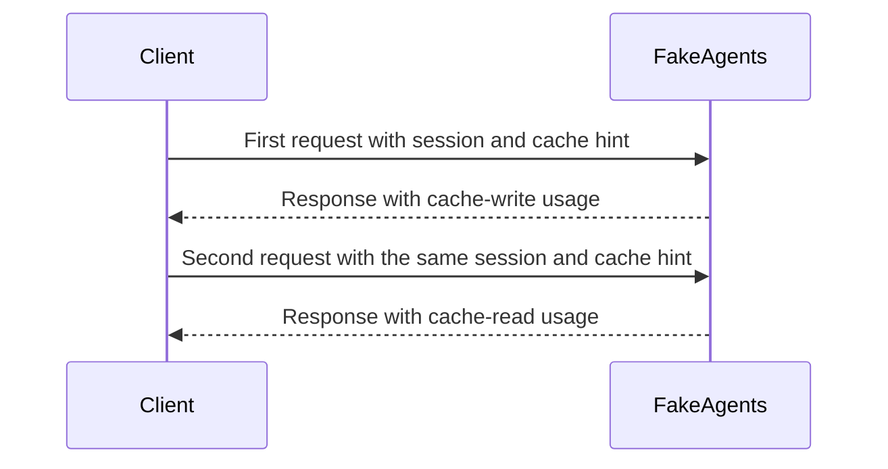
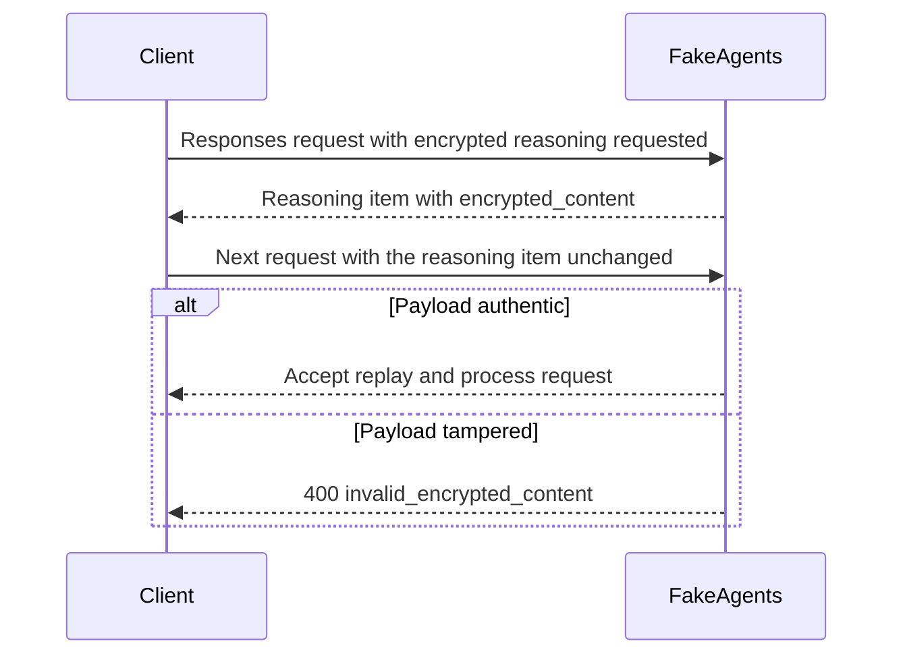
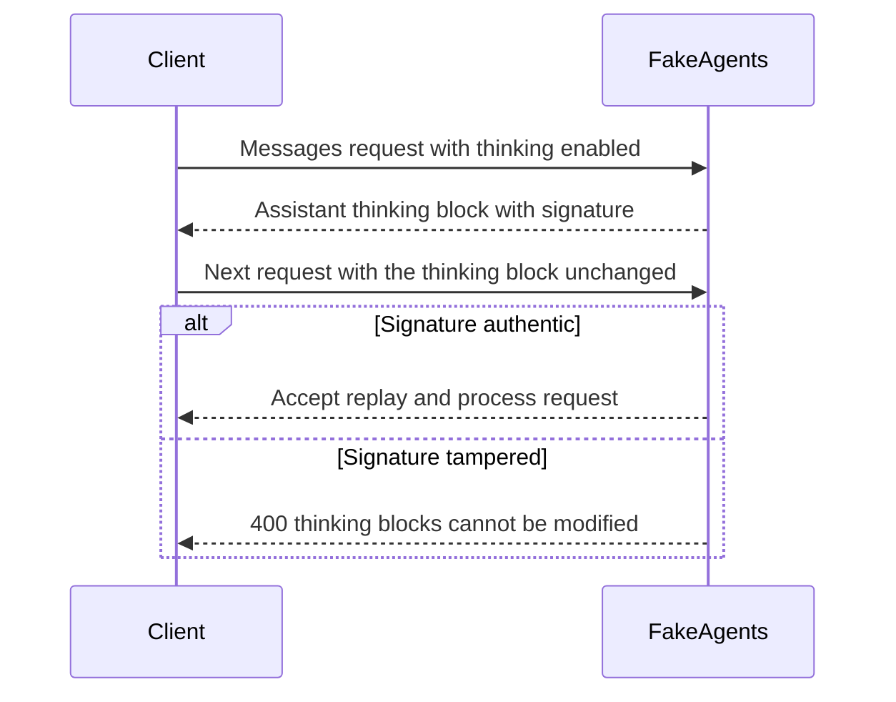
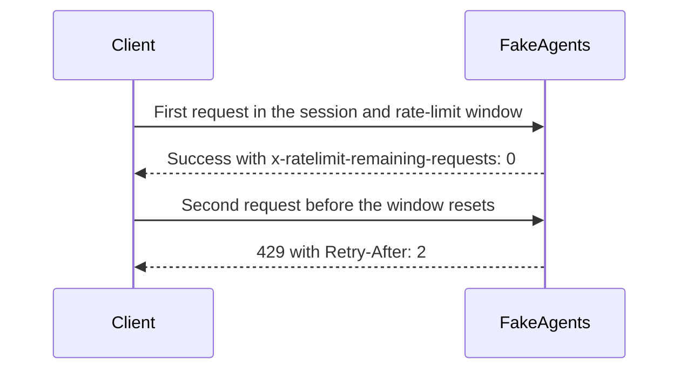

# Testing recipes

Copy-paste fixtures for the cases that matter when building an AI integration. All commands assume:

```bash
fakeagents serve -c fakeagents.json --no-latency
BASE=http://127.0.0.1:11110
SESSION='x-fakeagents-session: recipe'
```

Remove `--no-latency` when you want to test timing.

> **Safety:** FakeAgents only emits simulated tool calls. A real agent harness
> pointed at it will execute them. Scenario steps and templates can therefore
> run real commands. Use a disposable container, allowlist the command under
> test, and never mount production credentials into that container. The authors
> are not responsible for commands you configure or execute. See
> [SECURITY.md](../SECURITY.md).

## Normal response

```bash
curl -sS "$BASE/v1/chat/completions" \
  -H 'Content-Type: application/json' -H "$SESSION" \
  -d '{"model":"fake-gpt-4o","messages":[{"role":"user","content":"hello"}]}' | jq .
```

## Thinking on and off

OpenAI Chat:

```bash
# on
curl -sS "$BASE/v1/chat/completions" \
  -H 'Content-Type: application/json' -H "$SESSION" \
  -d '{"model":"fake-gpt-4o","reasoning_effort":"high","messages":[{"role":"user","content":"think"}]}' \
  | jq '.choices[0].message.reasoning_content, .usage.completion_tokens_details.reasoning_tokens'

# off
curl -sS "$BASE/v1/chat/completions" \
  -H 'Content-Type: application/json' -H "$SESSION" \
  -d '{"model":"fake-gpt-4o","messages":[{"role":"user","content":"think"}]}' \
  | jq '.choices[0].message | has("reasoning_content")'
```

OpenAI Responses:

```bash
curl -sS "$BASE/v1/responses" \
  -H 'Content-Type: application/json' \
  -d '{"model":"fake-gpt-5","input":"think","reasoning":{"effort":"high","summary":"auto"}}' \
  | jq '.output[] | select(.type=="reasoning")'
```

Anthropic:

```bash
curl -sS "$BASE/v1/messages" \
  -H 'Content-Type: application/json' -H 'anthropic-version: 2023-06-01' \
  -d '{"model":"fake-claude-sonnet","max_tokens":1024,"thinking":{"type":"adaptive"},"messages":[{"role":"user","content":"think"}]}' \
  | jq '.content[] | select(.type=="thinking")'
```

Force thinking regardless of the request with `[[fakeagents:thinking]]` or:

```json
{"defaults": {"thinking": {"mode": "always"}}}
```

## Tooling and final turn

```bash
curl -sS "$BASE/v1/chat/completions" \
  -H 'Content-Type: application/json' -H "$SESSION" \
  -d '{
    "model": "fake-gpt-4o",
    "messages": [{"role": "user", "content": "weather? [[fakeagents:tool-call]]"}],
    "tools": [{
      "type": "function",
      "function": {
        "name": "get_weather",
        "parameters": {
          "type": "object",
          "properties": {"city": {"type": "string"}},
          "required": ["city"]
        }
      }
    }]
  }' | jq '.choices[0] | {finish_reason, message}'
```

Send the tool result back with the same session to get the final answer:

```bash
curl -sS "$BASE/v1/chat/completions" \
  -H 'Content-Type: application/json' -H "$SESSION" \
  -d '{
    "model": "fake-gpt-4o",
    "messages": [
      {"role": "user", "content": "weather?"},
      {"role": "assistant", "content": null, "tool_calls": [{
        "id": "call_1", "type": "function",
        "function": {"name": "get_weather", "arguments": "{\"city\":\"example\"}"}
      }]},
      {"role": "tool", "tool_call_id": "call_1", "name": "get_weather", "content": "{\"temp\":31}"}
    ],
    "tools": [{"type": "function", "function": {"name": "get_weather", "parameters": {"type": "object"}}}]
  }' | jq -r '.choices[0].message.content'
```

Protocol-native alternative: send `"tool_choice": "required"` and no directive. FakeAgents calls the first tool.

For Anthropic, use `tools[].input_schema` and `"tool_choice": {"type":"any"}`.

## Agentic multi-turn and scripted tool errors

The built-in `tool-error` scenario triggers on the phrase **"test tool error"** and produces three turns: a declared tool, an undeclared tool with malformed arguments, then a final answer.

```bash
TOOLS='[{"type":"function","function":{"name":"get_weather","parameters":{"type":"object","properties":{"city":{"type":"string"}}}}}]'

# Turn 1: the model calls the declared tool.
TURN1=$(curl -sS "$BASE/v1/chat/completions" \
  -H 'Content-Type: application/json' -H "$SESSION" \
  -d "$(jq -n --argjson tools "$TOOLS" '{
    model: "fake-gpt-4o",
    tools: $tools,
    messages: [{role: "user", content: "please test tool error"}]
  }')")
CALL=$(jq -c '.choices[0].message.tool_calls[0]' <<<"$TURN1")
CALL_ID=$(jq -r '.id' <<<"$CALL")
jq -r '.choices[0].message.tool_calls[0].function.name' <<<"$TURN1"
# get_weather

# Turn 2: send the assistant tool call and its result back. FakeAgents calls
# an undeclared tool with malformed JSON arguments.
BODY2=$(jq -n --argjson tools "$TOOLS" --argjson call "$CALL" --arg id "$CALL_ID" '{
  model: "fake-gpt-4o",
  tools: $tools,
  messages: [
    {role: "user", content: "please test tool error"},
    {role: "assistant", content: null, tool_calls: [$call]},
    {role: "tool", tool_call_id: $id, name: "get_weather", content: "sunny"}
  ]
}')
TURN2=$(curl -sS "$BASE/v1/chat/completions" \
  -H 'Content-Type: application/json' -H "$SESSION" \
  -d "$BODY2")
CALL2=$(jq -c '.choices[0].message.tool_calls[0]' <<<"$TURN2")
CALL2_ID=$(jq -r '.id' <<<"$CALL2")
jq -r '.choices[0].message.tool_calls[0].function | [.name, .arguments] | @tsv' <<<"$TURN2"
# fakeagents_missing_tool    {"broken":

# Turn 3: the scripted final answer.
BODY3=$(jq -n --argjson tools "$TOOLS" --argjson call "$CALL" --arg id "$CALL_ID" \
  --argjson call2 "$CALL2" --arg id2 "$CALL2_ID" '{
    model: "fake-gpt-4o",
    tools: $tools,
    messages: [
      {role: "user", content: "please test tool error"},
      {role: "assistant", content: null, tool_calls: [$call]},
      {role: "tool", tool_call_id: $id, name: "get_weather", content: "sunny"},
      {role: "assistant", content: null, tool_calls: [$call2]},
      {role: "tool", tool_call_id: $id2, name: "fakeagents_missing_tool", content: "Error: tool not found"}
    ]
  }')
curl -sS "$BASE/v1/chat/completions" \
  -H 'Content-Type: application/json' -H "$SESSION" \
  -d "$BODY3" | jq -r '.choices[0].message.content'
```

Response headers include `X-FakeAgents-Step: 0`, `1`, and `2`. The step is derived from the number of assistant tool-call turns in the request, so no server-side cursor is needed. Force a turn with:

```bash
-H 'X-FakeAgents-Step: 2'
```

Harness-driven plan:

```json
{
  "defaults": {
    "tooling": {
      "mode": "agent",
      "plan": ["get_weather", "missing_tool"],
      "unknown_tool": "allow"
    }
  }
}
```

Or use the built-in `[[fakeagents:agentic]]` trigger. See [scenarios.md](scenarios.md#agentic-multi-turn-scripts).

## Real harness execution (`pwd`)

This verifies the complete loop: prompt → assistant tool call → harness executes
the command for real → tool result → assistant final answer.

The safe command used by the bundled stress test is `pwd`. Tool names are pinned
to the CLI versions in [stress/](../stress/):

| Harness | Tool name | Arguments | Approval used in the container |
|---|---|---|---|
| Codex CLI | `exec_command` | `{"cmd":"pwd"}` | `-s danger-full-access` |
| Claude Code | `Bash` | `{"command":"pwd"}` | `--allowedTools "Bash(pwd)"` |
| OpenCode | `bash` | `{"command":"pwd"}` | `--auto` |

Matching is per endpoint because the tool names differ:

```json
{
  "scenarios": [
    {
      "name": "harness-exec-codex",
      "priority": 200,
      "match": {"providers": ["openai"], "endpoints": ["responses"], "user_regex": "(?i)run pwd"},
      "respond": {"steps": [
        {"tool_calls": [{"name": "exec_command", "arguments": {"cmd": "pwd"}}]},
        {"text": "HARNESS_EXEC_OK: {{ .LastToolResult }}"}
      ]}
    },
    {
      "name": "harness-exec-claude",
      "priority": 200,
      "match": {"providers": ["anthropic"], "endpoints": ["messages"], "user_regex": "(?i)run pwd"},
      "respond": {"steps": [
        {"tool_calls": [{"name": "Bash", "arguments": {"command": "pwd"}}]},
        {"text": "HARNESS_EXEC_OK: {{ .LastToolResult }}"}
      ]}
    },
    {
      "name": "harness-exec-opencode",
      "priority": 200,
      "match": {"providers": ["openai"], "endpoints": ["chat.completions"], "user_regex": "(?i)run pwd"},
      "respond": {"steps": [
        {"tool_calls": [{"name": "bash", "arguments": {"command": "pwd"}}]},
        {"text": "HARNESS_EXEC_OK: {{ .LastToolResult }}"}
      ]}
    }
  ]
}
```

```bash
# Codex: execute exec_command with {"cmd":"pwd"}
codex exec -s danger-full-access --skip-git-repo-check -m gpt-5.4 \
  "Run pwd in the terminal and report the output."

# Claude Code: execute Bash with {"command":"pwd"}
claude -p "Run pwd in the terminal and report the output." \
  --model claude-sonnet-4-5 --output-format text --max-turns 3 \
  --allowedTools "Bash(pwd)"

# OpenCode: execute bash with {"command":"pwd"}
opencode run "Run pwd in the terminal and report the output." \
  --model fakeagents/fake-gpt-4o --auto
```

Expected output contains:

```text
HARNESS_EXEC_OK: ... /workspace ...
```

The exact final text is the tool output, because the scenario uses
`{{ .LastToolResult }}`. If a future CLI renames its shell tool, capture the new
tool catalog with `debug.record_tools: true` and `GET /_fakeagents/requests`.
These commands are safe only inside the disposable stress container; run them at
your own risk.

## Steering, queued messages, and two rooms

Start a slow first turn in the background, then send a second request in the same room while the first stream is still open. The built-in `steering` scenario advances through a stateful sequence.

```bash
# Room A: slow first turn, streaming in the background.
curl -sS -N "$BASE/v1/chat/completions" \
  -H 'Content-Type: application/json' \
  -H 'x-fakeagents-session: room-a' \
  -H 'X-FakeAgents-Scenario: steering' \
  -d '{"model":"fake-gpt-4o","stream":true,"messages":[{"role":"user","content":"work on the long task"}]}' \
  > /tmp/room-a.sse &
ROOM_A_PID=$!

# Both rooms can be active at once.
curl -sS -N "$BASE/v1/chat/completions" \
  -H 'Content-Type: application/json' \
  -H 'x-fakeagents-session: room-b' \
  -H 'X-FakeAgents-Scenario: steering' \
  -d '{"model":"fake-gpt-4o","stream":true,"messages":[{"role":"user","content":"work on the other task"}]}' \
  > /tmp/room-b.sse &
ROOM_B_PID=$!

sleep 0.3
curl -sS "$BASE/_fakeagents/active" | jq '.count'
# 2

# Steering message in room A while the first stream is still running.
curl -sS "$BASE/v1/chat/completions" \
  -H 'Content-Type: application/json' \
  -H 'x-fakeagents-session: room-a' \
  -H 'X-FakeAgents-Scenario: steering' \
  -d '{"model":"fake-gpt-4o","messages":[{"role":"user","content":"steer: use the other approach"}]}' \
  | jq -r '.choices[0].message.content'
# Steering message received: steer: use the other approach

wait "$ROOM_A_PID" "$ROOM_B_PID"
```

The second room advances its own cursor because sessions are independent. If a test needs deterministic turns, send `X-FakeAgents-Step: 0` / `1` / `2`; forced steps do not consume the sequence cursor. Reset with:

```bash
curl -X POST "$BASE/_fakeagents/reset"
```

## Multimodal input and media output

FakeAgents accepts image/document parts in all three chat surfaces and returns deterministic text. It does not inspect the bytes, so small placeholder payloads are enough for client/UI tests.

```bash
# OpenAI Chat image part
curl -sS "$BASE/v1/chat/completions" \
  -H 'Content-Type: application/json' -H "$SESSION" \
  -d '{"model":"fake-gpt-4o","messages":[{"role":"user","content":[
    {"type":"text","text":"what is in this image?"},
    {"type":"image_url","image_url":{"url":"data:image/png;base64,AA=="}}
  ]}]}' | jq -r '.choices[0].message.content'

# OpenAI Responses input_image
curl -sS "$BASE/v1/responses" \
  -H 'Content-Type: application/json' \
  -d '{"model":"fake-gpt-5","input":[{"type":"message","role":"user","content":[
    {"type":"input_text","text":"describe"},
    {"type":"input_image","image_url":"data:image/png;base64,AA=="}
  ]}]}' | jq -r '.output[] | select(.type=="message") | .content[0].text'

# Anthropic image block
curl -sS "$BASE/v1/messages" \
  -H 'Content-Type: application/json' -H 'anthropic-version: 2023-06-01' \
  -d '{"model":"fake-claude-sonnet","max_tokens":128,"messages":[{"role":"user","content":[
    {"type":"text","text":"describe"},
    {"type":"image","source":{"type":"base64","media_type":"image/png","data":"AA=="}}
  ]}]}' | jq -r '.content[] | select(.type=="text") | .text'
```

Media output endpoints return real PNG/WAV fixtures:

```bash
# Image generation (b64_json)
curl -sS "$BASE/v1/images/generations" \
  -H 'Content-Type: application/json' \
  -d '{"model":"gpt-image-1","prompt":"blue sky","size":"64x64"}' \
  | jq -r '.data[0].b64_json' | base64 -d > /tmp/fake.png

# Speech (binary audio)
curl -sS "$BASE/v1/audio/speech" \
  -H 'Content-Type: application/json' \
  -d '{"model":"gpt-4o-mini-tts","input":"hello","voice":"alloy","response_format":"wav"}' \
  -o /tmp/fake.wav
```

Transcription uses multipart upload and returns the configured text. See [stress](../stress/) and `internal/httpapi/media_test.go` for validated examples.

## Billing exhausted

```bash
curl -si "$BASE/v1/chat/completions" \
  -H 'Content-Type: application/json' -H "$SESSION" \
  -d '{"model":"fake-gpt-4o","messages":[{"role":"user","content":"[[fakeagents:billing]]"}]}'

curl -si "$BASE/v1/messages" \
  -H 'Content-Type: application/json' -H 'anthropic-version: 2023-06-01' \
  -d '{"model":"fake-claude-sonnet","max_tokens":64,"messages":[{"role":"user","content":"[[fakeagents:billing]]"}]}'
```

Expect OpenAI `429 insufficient_quota` and Anthropic `402 billing_error`.

## High and low throughput

Low throughput (2 tokens/sec, 2s TTFT):

```bash
curl -sS "$BASE/v1/chat/completions" \
  -H 'Content-Type: application/json' -H "$SESSION" \
  -d '{"model":"fake-gpt-4o","stream":true,"messages":[{"role":"user","content":"[[fakeagents:slow]]"}]}'
```

High throughput:

```bash
curl -sS "$BASE/v1/chat/completions" \
  -H 'Content-Type: application/json' -H "$SESSION" \
  -d '{"model":"fake-gpt-4o","stream":true,"messages":[{"role":"user","content":"[[fakeagents:fast]]"}]}'
```

Or configure exact rates:

```json
{
  "defaults": {
    "latency": {
      "time_to_first_token": {"min": "10ms", "max": "30ms"},
      "tokens_per_second": {"min": 500, "max": 1000}
    }
  }
}
```

Inspect the planned timing headers: `X-FakeAgents-TTFT-Ms`, `X-FakeAgents-Chunk-Ms`, `X-FakeAgents-Simulated-Ms`.

## Stream on and off

```bash
# stream
curl -sS -N "$BASE/v1/chat/completions" \
  -H 'Content-Type: application/json' -H "$SESSION" \
  -d '{"model":"fake-gpt-4o","stream":true,"stream_options":{"include_usage":true},"messages":[{"role":"user","content":"hello"}]}'

# buffered
curl -sS "$BASE/v1/chat/completions" \
  -H 'Content-Type: application/json' -H "$SESSION" \
  -d '{"model":"fake-gpt-4o","messages":[{"role":"user","content":"hello"}]}'
```

## Token usage

Computed usage:

```bash
curl -sS "$BASE/v1/chat/completions" \
  -H 'Content-Type: application/json' -H "$SESSION" \
  -d '{"model":"fake-gpt-4o","messages":[{"role":"user","content":"hello"}]}' | jq .usage
```

Exact override:

```json
{
  "name": "usage-fixture",
  "match": {"triggers": ["usage"]},
  "respond": {
    "type": "text",
    "usage": {"mode": "fixed", "input_tokens": 1000, "output_tokens": 200, "reasoning_tokens": 50, "cached_tokens": 128}
  }
}
```

Zero usage:

```json
{"defaults": {"usage": {"mode": "zero"}}}
```

Prompt cache simulation is enabled by default. Send `prompt_cache_key` (OpenAI) or `cache_control` (Anthropic) and make two requests in the same session; the first reports cache-write tokens and the second reports cache-read tokens:



## Encrypted reasoning and signatures

OpenAI Responses:

```bash
curl -sS "$BASE/v1/responses" \
  -H 'Content-Type: application/json' \
  -d '{"model":"fake-gpt-5","input":"hello","reasoning":{"effort":"medium"},"include":["reasoning.encrypted_content"]}' \
  | jq '.output[] | select(.type=="reasoning") | {summary, encrypted_content}'
```

Send the reasoning item back in `input` on the next request. A tampered blob returns `400 invalid_encrypted_content`.



Anthropic:

```bash
curl -sS "$BASE/v1/messages" \
  -H 'Content-Type: application/json' -H 'anthropic-version: 2023-06-01' \
  -d '{"model":"fake-claude-sonnet","max_tokens":512,"thinking":{"type":"adaptive"},"messages":[{"role":"user","content":"hello"}]}' \
  | jq '.content[] | select(.type=="thinking") | {thinking, signature}'
```

Replay the thinking block unmodified in the next assistant message. A tampered signature returns `400` with “thinking blocks cannot be modified”.



## Truncation

```bash
curl -sS "$BASE/v1/chat/completions" \
  -H 'Content-Type: application/json' -H "$SESSION" \
  -d '{"model":"fake-gpt-4o","max_tokens":10,"messages":[{"role":"user","content":"[[fakeagents:long]]"}]}' \
  | jq '.choices[0].finish_reason, .usage.completion_tokens'
```

Responses reports `status: "incomplete"` and `incomplete_details.reason: "max_output_tokens"`; Anthropic reports `stop_reason: "max_tokens"`.

## Rate limits and 429s

```json
{
  "rate_limit": {
    "enabled": true,
    "scope": "session",
    "requests_per_minute": 1,
    "retry_after": "2s"
  }
}
```

The first request succeeds with `x-ratelimit-remaining-requests: 0`; the second returns 429 and `Retry-After: 2`.



For a one-off 429 use `[[fakeagents:rate-limit]]`.

## Required custom header

```json
{
  "required_headers": [
    {"name": "x-opencode-session", "endpoints": ["chat.completions"]}
  ]
}
```

```bash
curl -si "$BASE/v1/chat/completions" \
  -H 'Content-Type: application/json' \
  -d '{"model":"fake-gpt-4o","messages":[{"role":"user","content":"hi"}]}'
# HTTP 400, code missing_required_header
```

## Authentication

```json
{"auth": {"mode": "required", "keys": [{"key": "sk-test"}]}}
```

```bash
curl -si "$BASE/v1/messages" \
  -H 'Content-Type: application/json' \
  -H 'anthropic-version: 2023-06-01' \
  -H 'x-api-key: wrong' \
  -d '{"model":"fake-claude-sonnet","max_tokens":32,"messages":[{"role":"user","content":"hi"}]}'
```

Expect 401. Health and debug endpoints stay exempt unless you remove them from `auth.exempt_paths`.

## Mid-stream failure

```bash
curl -sS -N "$BASE/v1/chat/completions" \
  -H 'Content-Type: application/json' -H "$SESSION" \
  -d '{"model":"fake-gpt-4o","stream":true,"messages":[{"role":"user","content":"[[fakeagents:mid-stream-error]]"}]}'
```

The HTTP status is 200, then an error frame arrives and the stream closes without `[DONE]`. Use `mid-stream-abort` for a silent disconnect.

## Structured output

```bash
curl -sS "$BASE/v1/chat/completions" \
  -H 'Content-Type: application/json' -H "$SESSION" \
  -d '{
    "model": "fake-gpt-4o",
    "messages": [{"role": "user", "content": "give me JSON"}],
    "response_format": {
      "type": "json_schema",
      "json_schema": {
        "name": "weather",
        "schema": {
          "type": "object",
          "properties": {
            "city": {"type": "string"},
            "temperature": {"type": "integer"},
            "conditions": {"type": "array", "items": {"type": "string"}}
          },
          "required": ["city", "temperature", "conditions"]
        }
      }
    }
  }' | jq '.choices[0].message.content | fromjson'
```

The same works for Responses `text.format` and Anthropic `output_config.format`.

## Unicode and chunk boundaries

```bash
curl -sS -N "$BASE/v1/chat/completions" \
  -H 'Content-Type: application/json' -H "$SESSION" \
  -d '{"model":"fake-gpt-4o","stream":true,"messages":[{"role":"user","content":"[[fakeagents:unicode]]"}]}'
```

Rune chunks never split UTF-8 sequences.

## State reset

```bash
curl -X POST "$BASE/_fakeagents/reset"
```

Resets sessions, the Responses store, rate-limit buckets, and the request recorder. Useful between tests when you want deterministic turn 0.

## Docker stress test

```bash
make stress
```

Runs Codex CLI, Claude Code CLI, and OpenCode CLI against FakeAgents inside Docker, then executes 33 contract checks (streaming, thinking, tools, billing, required headers, mid-stream errors, encrypted reasoning). The script exits non-zero on any failure.
